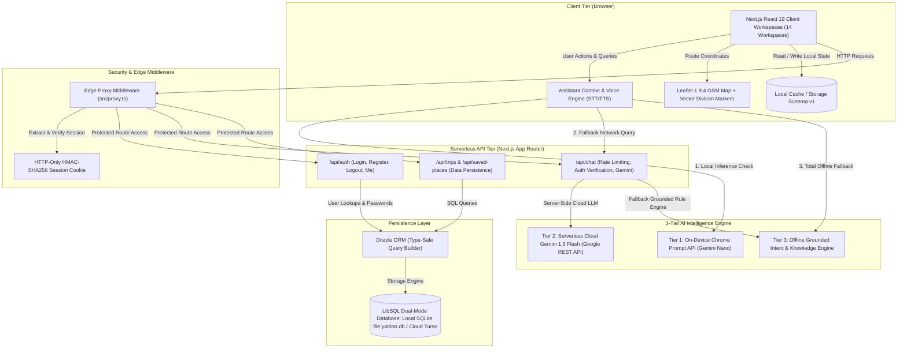

# Technical Architecture & Technology Stack

**Project:** Yatrion (ಯಾತ್ರಿಯಾನ್) — AI Travel Companion for Karnataka  
**Competition:** Kannada Digital Innovation Hackathon 2026

---

## 1. Complete Technology Stack

Yatrion is built on a modern, high-performance, strictly typed full-stack architecture optimized for low latency, zero API licensing costs, and robust offline capabilities.

| Layer | Technology | Version | Architectural Role |
|---|---|---|---|
| **Framework** | **Next.js (App Router)** | `16.4.3` | Server-rendered pages, edge middleware, API routes, Turbopack compilation. |
| **UI Library** | **React** | `19.3.0` | Declarative UI, Concurrent Mode, React Server Components. |
| **Language** | **TypeScript** | `5.x` | Strict type safety across models, APIs, and client contexts (0 errors). |
| **Styling** | **Tailwind CSS** | `4.x` | Utility-first responsive design, custom Karnataka palette tokens. |
| **Icons** | **Lucide React** | `1.64.0` | Accessible vector iconography across all workspaces. |
| **Cartography** | **Leaflet** | `1.9.4` | Zero-cost open-source map engine with OpenStreetMap tile layer. |
| **Database** | **LibSQL (`@libsql/client`)** | `0.18.0` | Dual-mode SQLite/Turso client for local edge and distributed cloud sync. |
| **ORM** | **Drizzle ORM** | `0.45.4` | Type-safe SQL schema definitions, migrations, and relational queries. |
| **Tokens & Crypto**| **jose** / **WebCrypto** | `6.2.15` | HMAC-SHA256 stateless session tokens and PBKDF2 password hashing. |
| **Voice & Audio** | **Web Speech / Web Audio** | *Browser Native* | SpeechRecognition STT, SpeechSynthesis TTS, procedural audio synthesis. |
| **Verification** | **Node.js / tsx** | `20+` | Custom deterministic test engine (`scripts/test-engine.ts`). |

---

## 2. System Architecture Diagram



---

## 3. Core Architectural Modules

The codebase is organized into high-cohesion, low-coupling directories:

```
src/
├── app/
│   ├── (auth)/             # Public authentication routes: /login, /signup
│   ├── api/                # Secure serverless API endpoints
│   │   ├── auth/           # Login, registration, session validation
│   │   ├── chat/           # Authenticated AI companion endpoint with rate-limiting
│   │   ├── trips/          # CRUD operations for traveler trips
│   │   └── saved-places/   # Bookmark persistence
│   ├── app/                # Authenticated platform shell layout & 14 workspaces
│   │   ├── dashboard/      # Central overview & rapid launcher
│   │   ├── explore/        # Karnataka 31-district secular directory
│   │   ├── attractions/    # Individual attraction pages ([id])
│   │   ├── planner/        # Smart multi-day trip configuration wizard
│   │   ├── itinerary/      # Interactive daily schedule studio
│   │   ├── routes/         # Topographic route optimizer & timeline
│   │   ├── budget/         # Three-scenario budget analyzer
│   │   ├── discover/       # Offbeat secular hidden gems
│   │   ├── group/          # Collaborative planning & debt settlement
│   │   ├── conditions/     # Weather forecasts & ghat road advisories
│   │   ├── adaptive/       # Dynamic replanning & disruption alerts
│   │   ├── saved/          # Bookmarked places workspace
│   │   ├── trips/          # Multi-trip manager
│   │   └── settings/       # Bilingual preferences & cloud synchronization
│   ├── globals.css         # Tailwind CSS 4 custom palette & Leaflet overrides
│   ├── layout.tsx          # Root HTML layout with font optimization
│   └── page.tsx            # Public landing page with real Leaflet showcase
├── components/
│   ├── app-shell/          # Sidebar, header, navigation, and audio feedback
│   ├── assistant/          # AI companion floating modal & message bubbles
│   ├── landing/            # Real Leaflet landing map & discovery manifesto
│   ├── map/                # LeafletInteractiveMap & KarnatakaOfflineMap
│   └── [workspace]/        # Workspace-specific UI components
├── lib/
│   ├── assistant/          # 3-tier assistant service, intent engine, knowledge engine
│   ├── auth/               # HMAC session verification, PBKDF2 hashing, user store
│   ├── db/                 # LibSQL client, Drizzle schema, automated migrations
│   ├── explore/            # 31-district secular travel dataset (1,478 LOC)
│   ├── routes/             # Topographic distance matrix & speed calibration
│   ├── budget/             # 3-scenario budget calculation algorithms
│   ├── group/              # Minimal-debt bipartite settlement engine
│   ├── i18n/               # English (en.ts) & authentic Kannada (kn.ts) dictionaries
│   └── storage/            # Dual-mode synchronization service (localStorage + LibSQL)
└── proxy.ts                # Next.js edge-compatible proxy middleware
```

---

## 4. Dual-Mode Database & Storage Architecture

Yatrion implements a **Dual-Mode Persistence Architecture** that provides seamless continuity across offline local use, single-device development, and multi-device cloud synchronization:

1. **Local SQLite Development Engine**:
   - Out of the box, Yatrion connects to an embedded SQLite database (`file:yatrion.db`) managed via `@libsql/client`.
   - Requires zero external credentials, zero cloud dependencies, and zero setup.
   - Automatically migrates database tables on initial startup (`users`, `trips`, `saved_places`).
2. **Distributed Cloud LibSQL (Turso)**:
   - When production environment variables `TURSO_DATABASE_URL` and `TURSO_AUTH_TOKEN` are present, the client automatically switches to distributed edge LibSQL without code changes.
   - Synchronizes traveler data across devices with sub-10ms query times.
3. **Client-Side Schema Versioning (`yatrion-trip-v1`)**:
   - All browser-persisted state is strictly validated using versioned schema guards (`yatrion-trip-v1`, `yatrion-language-pref-v1`).
   - Corrupted, outdated, or malformed payloads are safely rejected and re-initialized, preventing blank screen crashes.

---

## 5. Security & Authentication Architecture

- **Stateless HMAC-SHA256 Tokens**:
  - Authenticated sessions use cryptographically signed tokens containing the traveler's `userId`, `email`, and expiration timestamp.
  - Stored in secure `HTTP-Only`, `SameSite=Lax` cookies, preventing cross-site scripting (XSS) token extraction.
- **Cryptographic Password Hashing**:
  - Passwords are salted with 16 bytes of cryptographically secure random bytes and hashed using PBKDF2 with SHA-256 (100,000 iterations via WebCrypto).
- **Demo Traveler Sandbox Isolation**:
  - Evaluators can test the complete platform with a single click using the **Demo Traveler** session.
  - Demo accounts operate in a sandboxed partition with a strict `demo_` prefix, completely isolating test mutations from real user accounts.
- **API Guarding & Rate Limiting**:
  - The `/api/chat` route enforces session authentication and in-memory rate limiting (minimum 500ms per request per user), preventing denial-of-service abuse.

---

## 6. Next.js 16 SSR & Hydration Safety

- **Leaflet Hydration Guard**:
  - Leaflet directly accesses browser DOM primitives (`window`, `document`), which trigger fatal `ReferenceError` crashes during Next.js server-side rendering (SSR).
  - Yatrion encapsulates all Leaflet components inside dynamic imports (`next/dynamic(..., { ssr: false })`) paired with a runtime `typeof window !== "undefined"` mount guard.
- **Clean Turbopack Compilation**:
  - 63 out of 63 App Router pages compile successfully in ~1.7 seconds with zero warnings or hydration mismatches.

