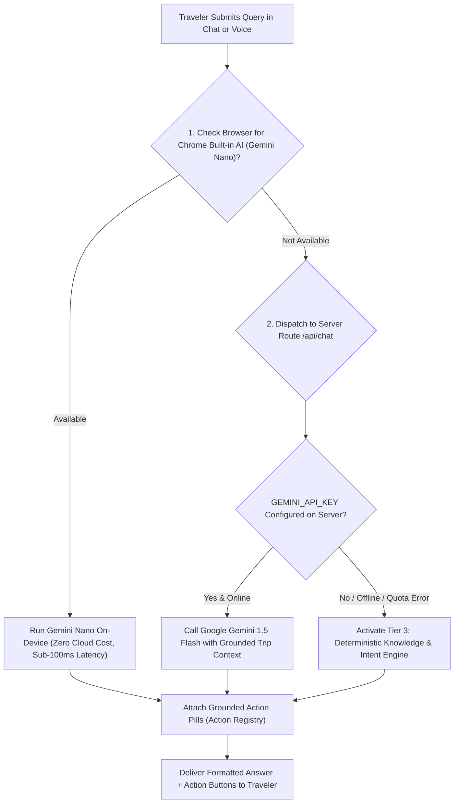
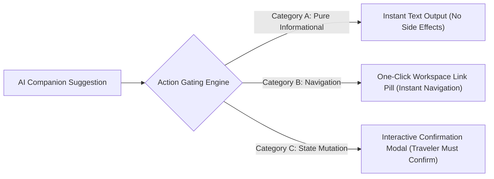

# AI Implementation & Zero-Cost Fallback Engine

**Project:** Yatrion (ಯಾತ್ರಿಯಾನ್) — AI Travel Companion for Karnataka  
**Competition:** Kannada Digital Innovation Hackathon 2026

---

## 1. The Core AI Philosophy: Grounded & Deterministic-First

Generic Large Language Models (LLMs) are notorious for hallucinating travel logistics—inventing bus numbers, fabricating entry ticket prices, and suggesting physically impossible day journeys across the Western Ghats.

Yatrion rejects ungrounded generation. Our architecture adopts a **Deterministic-First AI Philosophy**:
1. All core logistics (routing, distance matrices, budget scenario modeling, group debt minimization) are solved using deterministic algorithms and verified public datasets.
2. The generative AI layer serves as an **intelligent conversational translator, contextual summarizer, and adaptive interface layer**, strictly grounded in the traveler's active state.
3. The platform features an **independent, zero-cost deterministic fallback engine** that delivers rich, grounded travel intelligence even if all cloud APIs are disconnected or unavailable.

---

## 2. The 3-Tier Adaptive Intelligence Pipeline

### Tier 1: On-Device Chrome Built-in AI (Gemini Nano)
- **Mechanism**: Probes the emerging Web platform API (`window.ai.languageModel`) in supported Chromium browsers.
- **Benefits**:
  - **Zero Server Cost**: Runs entirely on the user's local CPU/NPU.
  - **Zero Latency**: Eliminates round-trip HTTP overhead.
  - **Total Data Privacy**: Trip itinerary and personal budget remain on the traveler's physical device.
- **System Grounding**: Injects a strict system prompt instructing the model to adhere to verified Karnataka geography and prevent hallucinated ticket fees.

### Tier 2: Serverless Cloud Gemini 1.5 Flash
- **Mechanism**: Dispatches authenticated queries to the Next.js `/api/chat` route handler, which interfaces with Google Generative Language API (`gemini-1.5-flash`).
- **Contextual Prompt Injection**: Dynamically injects the traveler's comprehensive live state into the system instruction:
  - Active trip destination list and duration.
  - Current daily schedule and next scheduled stop.
  - Selected budget tier (Saver/Balanced/Comfort) and expense allocation.
  - Environmental alerts and weather conditions from Open-Meteo.
  - User's preferred language (English or authentic Kannada).
- **Inference Configuration**: Configured with a low temperature (`0.4`) and concise output token limit (`800`) to guarantee crisp, factual, mobile-optimized responses.

### Tier 3: Grounded Knowledge & Intent Engine (100% Zero-Cost Fallback)
- **The Ultimate Resilience Layer**: If the traveler is offline, if the server lacks an API key, or if network connectivity is severed on a remote forest trail, Tier 3 takes over automatically.
- **Intent Classification**: Evaluates traveler queries against an extensive pattern classifier covering 12 travel intents:
  - `trip_overview`: Summarizes the active itinerary, stops, and pace.
  - `budget_inquiry`: Breaks down estimated costs across the 6 expenditure categories.
  - `route_query`: Reports road conditions, ghat speeds, and estimated transit times.
  - `destination_inquiry`: Retrieves verified facts, timings, and elevations from `district-data.ts`.
  - `weather_advisory`: Interprets temperature, rain alerts, and safety precautions.
  - `gem_discovery`: Recommends nearby offbeat secular monuments.
  - `group_settlement`: Summarizes group debt balances and minimum settlement transactions.
  - `emergency_contacts`: Delivers instant regional helplines (Karnataka Tourism, KSDMA, Police).
- **Guaranteed Output**: Deterministic, zero hallucinations, instant response time, and 100% functional with zero API keys or credit cards.

---

## 3. Strict Anti-Hallucination Guardrails

To protect travelers from hazardous travel misinformation, Yatrion enforces four programmatic anti-hallucination invariants across all AI prompts:

1. **No Fictional Pricing**: Models are explicitly forbidden from inventing exact monument entry tickets, dynamic train/bus fares, or hotel room rates. All monetary values are designated as planning estimates based on established ranges.
2. **Strict Secular Invariant**: Queries regarding religious rituals or pilgrimage shrines are respectfully redirected toward secular heritage, natural monuments, and architectural marvels.
3. **Disruption Provenance**: Weather forecasts must explicitly cite Open-Meteo (under CC BY 4.0), and road closures must cite Karnataka PWD / KSDMA bulletins. If no official notices exist, the AI explicitly notes that lack of alerts does not guarantee zero road hazards.
4. **User Autonomy**: The AI companion is architecturally prohibited from autonomously modifying traveler itineraries or approving replanning proposals without explicit traveler confirmation.

---

## 4. The 3-Tier Safe Action Gating Framework

When the AI companion answers a user query, it frequently suggests actionable next steps. To prevent destructive autonomous actions, Yatrion routes all suggestions through a **3-Tier Action Gate**:

- **Category A (Informational)**: Contextual explanations, historical notes, packing checklists. Rendered directly as formatted Markdown with bold headings and bullet points.
- **Category B (Navigation Actions)**: Contextual buttons that direct the traveler to relevant workspaces (e.g., *"View Route Map"*, *"Inspect Budget Breakdown"*, *"Explore Mullayanagiri"*). Executed instantly with zero state mutation.
- **Category C (Mutating Actions)**: High-impact actions that modify traveler data (e.g., *"Reset Active Itinerary"*, *"Recalculate Budget to Saver Tier"*, *"Remove Activity Stop"*). The AI **cannot** execute these directly; instead, it triggers an explicit visual confirmation modal requiring the traveler's manual authorization.

---

## 5. Bilingual Voice Intelligence & Phonetic Cleanse

Yatrion's voice assistant is integrated with browser-standard Web Speech APIs (`SpeechRecognition` and `SpeechSynthesis`). To ensure natural, distortion-free audio output, all generated text passes through a **phonetic cleansing pipeline**:
- **Currency Normalization**: Converts raw currency symbols like `₹1,500` into readable phonetic strings (*"1,500 Rupees"* or *"1,500 ರೂಪಾಯಿಗಳು"*).
- **Markdown Stripping**: Removes asterisks (`**`), hash headers (`###`), backticks, and bullet characters that cause speech synthesis engines to stutter or pronounce punctuation.
- **URL & Bracket Sanitization**: Strips URLs, markdown links, and technical brackets.
- **Voice Profile Matcher**: Automatically inspects the operating system's installed voice synthesis profiles, prioritizing native Kannada voices (`kn-IN`) when in Kannada mode and Indian English voices (`en-IN`) when in English mode.

