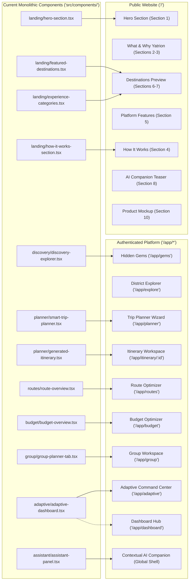

# Yatrion Architecture Evolution: Current vs. Target
## Part 11A · Phase 0: Gap Analysis & Structural Blueprint

**Document:** Current vs. Target Architecture Analysis  
**Project:** Yatrion — Intelligent Travel Planner for Karnataka  
**Phase:** Part 11A · Phase 0 (Read-Only Planning)  
**Date:** November 2026  

---

## 1. Executive Summary & Strategic Rationale

Until Part 10, Yatrion followed a single-page hybrid model: visiting `http://localhost:3000/` loaded a landing hero, destination preview cards, an embedded discovery explorer, a how-it-works section, and an embedded trip planning form that expanded in-place into an itinerary generator, route optimizer, budget analyzer, group collaboration board, and adaptive travel intelligence dashboard.

While this single-page hybrid was effective for rapid development and algorithmic verification (Parts 5–10), it presents critical usability, architectural, and business challenges:
1. **Confused User Journey:** Casual visitors seeking information are immediately presented with a complex travel planning interface requiring detailed inputs.
2. **Missing Product Onboarding:** The value proposition, intelligence algorithms, and Karnataka-specific innovations are overshadowed by the immediate presence of form controls.
3. **No True Personalization or Account Lifecycle:** All trip data is tied to a single browser LocalStorage key without user accounts, multi-trip archives, or personalized profiles.
4. **Single-Page DOM & State Bloat:** Mounting the entire itinerary engine, interactive SVG timeline, Open-Meteo telemetry fetcher, and group voting room on the root route creates unnecessary memory overhead and complex scroll management.

**The Target Architecture establishes two completely decoupled experiences:**
* **Experience 1:** A single-page, conversion-optimized, editorial **Public Introductory Website** on `/`.
* **Experience 2:** A dedicated, multi-page, authenticated **Travel Application Platform** on `/app/*`.

---

## 2. Route Map & Directory Structure Comparison

### 2.1 Current File Structure (Monolithic Hybrid)

```
src/app/
├── globals.css              # Global styles & Tailwind v4 theme tokens
├── layout.tsx               # Root layout: SiteHeader, SiteFooter, AssistantProvider, FloatingAssistantButton
├── page.tsx                 # Monolithic page: Hero + FeaturedDestinations + DiscoveryExplorer + HowItWorks + SmartTripPlanner + Cta
├── loading.tsx              # Generic loading fallback
├── error.tsx                # Error boundary
├── not-found.tsx            # 404 page
└── api/
    └── chat/
        └── route.ts         # Serverless AI companion chat endpoint
```

### 2.2 Target File Structure (Decoupled Route Groups)

```
src/
├── middleware.ts            # Next.js Edge Middleware for route protection & session validation
├── app/
│   ├── globals.css
│   ├── layout.tsx           # Minimal root layout (HTML, body, global fonts, LanguageProvider)
│   ├── (public)/            # Route Group 1: Public Introductory Website
│   │   ├── layout.tsx       # Public layout (PublicHeader, PublicFooter, No Authenticated Sidebar)
│   │   └── page.tsx         # ONE Single-Page website with 12 smooth-scrolling sections
│   │
│   ├── (auth)/              # Route Group 2: Authentication Flows
│   │   ├── layout.tsx       # Centered editorial auth layout with high-res Karnataka imagery
│   │   ├── login/
│   │   │   └── page.tsx     # Sign-in form + Demo Account instant login
│   │   └── signup/
│   │       └── page.tsx     # New user registration + Guest preferences linking
│   │
│   ├── (app)/               # Route Group 3: Authenticated Travel Platform (Protected by Middleware)
│   │   ├── layout.tsx       # App Shell: Sidebar, TopBar, ActiveTripContext, AssistantProvider
│   │   ├── dashboard/
│   │   │   └── page.tsx     # Personal Dashboard (Central Hub, Active Trip Health, Alerts)
│   │   ├── explore/
│   │   │   ├── page.tsx     # Complete Karnataka Explorer (31 Districts, 10 Secular Categories)
│   │   │   └── [district]/
│   │   │       └── page.tsx # District-specific attraction catalog & seasonal guide
│   │   ├── attractions/
│   │   │   └── [id]/
│   │   │       └── page.tsx # Attraction Detail View (Coordinates, entry fees, accessibility, tips)
│   │   ├── planner/
│   │   │   └── page.tsx     # Smart Trip Planner Wizard (1-7 days, pacing, budget, origin)
│   │   ├── itinerary/
│   │   │   └── [id]/
│   │   │       └── page.tsx # Interactive Itinerary View (Day schedule, drag/drop, notes, export)
│   │   ├── routes/
│   │   │   └── page.tsx     # Dedicated Route Optimization Workspace (Ghat multipliers, legs, maps)
│   │   ├── budget/
│   │   │   └── page.tsx     # Dedicated Budget Optimizer Workspace (3 scenarios, vehicle sharing)
│   │   ├── gems/
│   │   │   └── page.tsx     # Dedicated Hidden Gems Discovery (40+ offbeat experiences)
│   │   ├── group/
│   │   │   └── page.tsx     # Dedicated Group Collaboration Workspace (Profiles, voting, expense split)
│   │   ├── adaptive/
│   │   │   └── page.tsx     # Adaptive Travel Command Center (Open-Meteo, PWD alerts, replanning)
│   │   ├── conditions/
│   │   │   └── page.tsx     # Live Weather & Disruption Map (Interactive environmental telemetry)
│   │   ├── saved/
│   │   │   └── page.tsx     # Saved Attractions & Custom Bucket Lists
│   │   ├── trips/
│   │   │   └── page.tsx     # My Trips Archive (Active, upcoming, past trips, export manager)
│   │   └── settings/
│   │       └── page.tsx     # User Profile, Travel Preferences, Language, Mobility Profiles
│   │
│   └── api/
│       ├── auth/
│       │   ├── login/route.ts   # Session generation & HTTP-only cookie dispatch
│       │   ├── logout/route.ts  # Session clearance
│       │   └── me/route.ts      # Active session verification
│       └── chat/
│           └── route.ts         # Serverless AI companion endpoint (Unified Context aware)
```

---

## 3. Side-by-Side Architectural Gap Analysis

| Architectural Dimension | Current Implementation (Part 10) | Target Implementation (Part 11A) | Impact & Rationale |
|-------------------------|----------------------------------|----------------------------------|-------------------|
| **Primary Route Model** | Single root route (`/`) containing marketing, planning, budgeting, and dashboard. | Decoupled route groups: `(public)` at `/`, `(auth)` at `/login`, and `(app)` at `/app/*`. | Eliminates cognitive overload; gives each complex feature a focused, bookmarkable workspace. |
| **Public Experience** | Hybrid page with incomplete marketing copy immediately followed by planner inputs. | Dedicated 12-section editorial showcase strictly introducing Yatrion with zero planning forms. | Maximizes conversion, tells an articulate story of Karnataka travel, and clearly explains AI capabilities. |
| **Authentication & Access** | No authentication. Open access to all features on a single unauthenticated URL. | Zero-cost encrypted session cookies with Next.js Edge Middleware route protection. | Protects user trips, enables multi-trip persistence, and establishes a genuine account model. |
| **Post-Login Starting Point** | None. User is always on `/` and must scroll down to find their generated trip. | **Personal Dashboard (`/app/dashboard`)** featuring active trip cards, health badges, alerts, and quick actions. | Creates an intuitive home base for travellers managing current and upcoming journeys. |
| **Karnataka Attractions Database** | 11 destination hubs with mixed secular and religious attractions (~45 total attractions). | Comprehensive 31-district database with strictly non-religious attractions (150+ verified attractions). | Fully honors Karnataka tourism diversity across all administrative divisions while strictly excluding religious sites. |
| **Navigation Shell** | Fixed top header with anchor links (`#destinations`, `#planner`) on every view. | Separate Public Header (smooth-scroll) vs. Authenticated App Shell (Collapsible Sidebar + Top Bar). | Tailored navigation ergonomics for both public storytelling and high-density travel planning. |
| **State Persistence** | Single LocalStorage key `yatrion-trip-v1` overwriting the only active trip. | User-scoped multi-trip store (`yatrion-trips-[userId]`) with active trip pointer and cloud-ready structure. | Allows users to create, archive, and manage multiple trips across different seasons and regions. |
| **AI Companion Integration** | Floating assistant button mounted globally across the entire monolithic page. | Dual role: Interactive teaser demo on public page; full contextual companion across all `/app/*` workspaces. | Public visitors experience a controlled preview; authenticated users get deep workspace actions. |
| **Voice Talkbot Experience** | Mounted globally in assistant panel; interacts with the single planner on page. | Contextual speech talkbot dynamically aware of the active page (Route, Budget, Adaptive, Explorer). | Voice interactions adapt vocabulary and actions based on whether the user is on the map, budget, or dashboard. |

---

## 4. Component Migration & Relocation Matrix

Every component developed across Parts 1 through 10 is preserved. The table below charts their exact transition from the monolithic page into the decoupled architecture:



---

## 5. State Management & Persistence Evolution

### 5.1 Storage Schema Modernization
Currently, `src/lib/trip-storage.ts` validates a single storage key `TRIP_STORAGE_KEY = "yatrion-trip-v1"`. In the target architecture, storage is extended into a multi-trip, user-scoped repository:

```typescript
// Target User Session Model (Stored in Signed HTTP-Only Cookie + Client Auth State)
export interface YatrionUser {
  id: string;                      // Unique user UUID (e.g. "usr-7f9a2b")
  name: string;                    // User full name
  email: string;                   // User email address
  isDemoUser: boolean;             // True if instant guest demo session
  createdAt: string;               // ISO 8601 registration date
  preferredLanguage: "en" | "kn";  // User language preference
  defaultOrigin: string;           // Default starting hub (e.g. "Bengaluru")
  travelStyle: "relaxed" | "balanced" | "packed";
  accessibilityPreference?: "none" | "step_free" | "wheelchair" | "low_walking";
}

// Multi-Trip User Archive Schema (Stored in localStorage key 'yatrion-trips-[userId]')
export interface UserTripsArchive {
  version: 2;
  userId: string;
  activeTripId: string | null;     // Pointer to currently active itinerary
  trips: Record<string, StoredTripRecord>;
  savedAttractionIds: string[];    // Bookmarked attraction IDs across 31 districts
  savedGemIds: string[];           // Saved Hidden Gems
}

export interface StoredTripRecord {
  id: string;
  title: string;
  createdAt: string;
  updatedAt: string;
  departureDate?: string;
  preferences: TripPreferences;
  itinerary: GeneratedItinerary;
  editedDays: ItineraryDay[];
  routePlan?: OptimizedRoutePlan;
  budgetPlan?: OptimizedBudgetPlan;
  groupState?: GroupTripState;
  acceptedRecommendationIds: string[];
  rejectedRecommendationIds: string[];
  dayNotes: Record<number, string>;
  stopNotes: Record<string, string>;
  completedStopKeys: string[];
}
```

### 5.2 Guest-to-User State Migration Strategy
When a new visitor explores the public landing page, any temporary selections (such as selected destinations in interactive previews) are held in memory or transient sessionStorage. Upon clicking **"Sign Up"** or **"Try Demo"**:
1. The auth endpoint issues the signed session cookie.
2. The client auth provider checks for existing transient trip drafts.
3. Any drafted trip is seamlessly imported into the user's `UserTripsArchive`.
4. The user is redirected directly to `/app/dashboard`, with their drafted trip immediately visible and ready for optimization.

---

## 6. AI Travel Companion & Voice Talkbot Dual-Role Strategy

| Capability | Public Introductory Website (`/`) | Authenticated Travel Platform (`/app/*`) |
|------------|-----------------------------------|------------------------------------------|
| **Primary Purpose** | Product demonstration, value showcase, visitor engagement. | Active journey copilot, contextual navigation, replanning adviser. |
| **Assistant Presence** | Embedded within Section 8 as an interactive interactive preview card (optional minimized floating teaser). | Persistent floating button (`FloatingAssistantButton`) and slide-over panel on all `/app/*` routes. |
| **Query Scope** | Answering general questions about Karnataka travel, explaining Yatrion features, demonstrating voice languages. | Full access to the active trip's `UnifiedTripIntelligenceContext`, route transit times, budget deficits, and Open-Meteo alerts. |
| **State Mutation Policy** | Zero state access. Cannot modify or plan trips; prompts visitor to create an account. | Advisory action buttons that emit typed navigation triggers (`review_replanning_proposal`, `view_budget`, `jump_to_day`). |
| **Voice Talkbot (STT / TTS)** | Audio preview playing sample pre-recorded or synthesized Karnataka travel advice in Kannada, English, Hindi, and Telugu. | Live browser-native Web Speech recognition and synthesis for hands-free planning and in-trip guidance. |
| **Safety Disclaimers** | Informs visitors that full intelligence features require an active trip itinerary inside the platform. | Strict 5-part explainable responses with explicit provenance and absence-of-disruption caveats. |

---

## 7. Next Steps & Transition Plan

This gap analysis establishes the structural boundaries between the two experiences. The next document, [`docs/part11a-karnataka-attraction-data-strategy.md`](file:///Users/liyakatali/AI%20Travel%20Planner%20for%20Karnataka/docs/part11a-karnataka-attraction-data-strategy.md), details the complete 31-district non-religious attraction database architecture.

