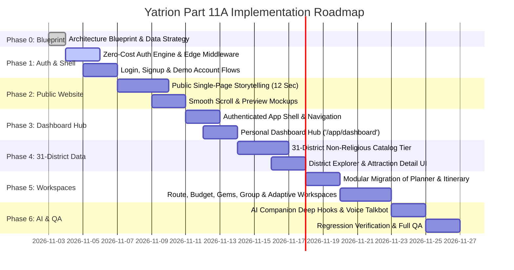

# Yatrion Implementation Roadmap: Decoupled Platform Transition
## Part 11A · Phase 0: Phased Execution Plan & Quality Verification

**Project:** Yatrion — Intelligent Travel Planner for Karnataka  
**Document:** Phased Implementation Roadmap & Engineering Plan  
**Phase:** Part 11A · Phase 0 (Read-Only Planning)  
**Date:** November 2026  

---

## 1. Executive Summary

This roadmap outlines the precise engineering sequence for transitioning Yatrion from its current single-page hybrid structure into two decoupled, high-performance experiences:
1. **The Public Introductory Website (Single Page):** A conversion-focused, storytelling landing page at `/`.
2. **The Authenticated Travel Platform (Multi-Page):** A feature-rich travel operating system anchored by a Personal Dashboard at `/app/dashboard`, surrounded by dedicated workspaces.

### Core Non-Negotiable Invariants:
* **Preserve 100% of Working Algorithmic Capabilities:** All existing engines—Smart Route Optimization (Part 10 Stage 1), Intelligent Budget Optimizer (Part 10 Stage 2), Hidden Gems Discovery (Part 10 Stage 3), Group Trip Collaboration (Part 10 Stage 4), and Adaptive Travel Intelligence (Part 10 Stage 5)—remain fully functional and are relocated to dedicated workspaces.
* **Strict Non-Religious Attraction Policy:** Zero temples, mosques, churches, or pilgrimage shrines in the expanded 31-district attraction database.
* **Zero-Cost Mandate:** Self-hosted authentication, keyless Open-Meteo weather telemetry, and browser-native Web Speech API. Zero paid third-party dependencies.
* **Quality Gate Integrity:** Every implementation phase must pass `npx tsc --noEmit` (0 errors), `npm run lint` (0 errors, 0 warnings), `npm test` (100% pass rate), and `npm run build` (Next.js Turbopack).

---

## 2. Phase-by-Phase Implementation Roadmap

---

### Phase 1: Zero-Cost Authentication Engine & Route Protection Infrastructure

#### Objectives:
* Establish Next.js App Router route groups: `(public)`, `(auth)`, and `(app)`.
* Implement self-hosted session authentication via signed HTTP-only cookies (`jose` / standard Web Crypto API).
* Implement Next.js Edge Middleware (`middleware.ts`) to enforce route protection:
  * Redirect unauthenticated requests to `/app/*` -> `/login?redirect=...`.
  * Redirect authenticated visitors from `/login` or `/signup` -> `/app/dashboard`.
* Build clean, editorial `/login` and `/signup` views with a prominent **"Try Demo Account"** one-click access button.
* Implement user session context provider (`AuthProvider` & `useAuth()`).

#### Key Deliverables:
1. `src/middleware.ts`
2. `src/lib/auth/auth-types.ts`, `src/lib/auth/auth-service.ts`, `src/lib/auth/auth-context.tsx`
3. `src/app/api/auth/login/route.ts`, `src/app/api/auth/signup/route.ts`, `src/app/api/auth/logout/route.ts`, `src/app/api/auth/me/route.ts`
4. `src/app/(auth)/layout.tsx`, `src/app/(auth)/login/page.tsx`, `src/app/(auth)/signup/page.tsx`

---

### Phase 2: Public Introductory Single-Page Website

#### Objectives:
* Create a dedicated single-page introductory website at `src/app/(public)/page.tsx` containing the **12 mandatory sections**:
  1. Hero section introducing Yatrion.
  2. What Yatrion is.
  3. Why Yatrion exists (Problem vs. Solution).
  4. How Yatrion works (3-step flow).
  5. Main platform features (6 core capabilities).
  6. Karnataka travel discovery introduction.
  7. Destination & experience previews (non-religious highlights).
  8. AI travel companion teaser & sample voice query preview.
  9. Benefits of using Yatrion (quantifiable travel value).
  10. Product & dashboard interactive perspective previews.
  11. High-conversion Sign Up & Login calls to action.
  12. Public editorial footer with language switcher & legal notes.
* Ensure navigation strictly scrolls between on-page sections (`#what`, `#why`, `#how-it-works`, `#features`, `#discovery`, `#ai-companion`, `#previews`).
* Completely remove the interactive trip planner, itinerary editor, and dashboard widgets from this introductory page.

#### Key Deliverables:
1. `src/app/(public)/layout.tsx` (Public header with smooth-scroll anchors, Auth CTAs, Language switcher)
2. `src/app/(public)/page.tsx` (The 12-section storytelling page)
3. `src/components/public/` (Componentized implementations of all 12 sections)

---

### Phase 3: Authenticated App Shell & Personal Dashboard Hub

#### Objectives:
* Build the authenticated application shell in `src/app/(app)/layout.tsx` with:
  * Collapsible sidebar navigation (Dashboard, Explore, Planner, Routes, Budget, Gems, Group, Adaptive, Trips, Saved, Settings).
  * Top utility bar (Active trip status badge, Live Open-Meteo weather ticker, Language toggle, User profile dropdown, Logout).
* Build the **Personal Dashboard** (`src/app/(app)/dashboard/page.tsx`) as the central post-authentication starting point:
  * **Active Trip Card:** Countdown to departure date, route distance, stops count, and Trip Health status.
  * **Quick Actions:** *"New Trip"*, *"Resume Planning"*, *"Explore 31 Districts"*, *"Review Adaptive Suggestions"*.
  * **Environmental Alerts:** Live Open-Meteo weather summaries and PWD road notices for the user's active itinerary.
  * **Recent Activity & Saved Bookmarks:** Quick access to recently saved hidden gems and districts.
  * **Group Voting Reminders:** Unvoted group activity decisions.

#### Key Deliverables:
1. `src/app/(app)/layout.tsx`
2. `src/components/app-shell/sidebar-nav.tsx`, `src/components/app-shell/top-bar.tsx`
3. `src/app/(app)/dashboard/page.tsx`
4. `src/components/dashboard/active-trip-card.tsx`, `src/components/dashboard/weather-alerts-strip.tsx`, `src/components/dashboard/quick-actions-hub.tsx`

---

### Phase 4: Complete 31-District Non-Religious Attraction Database & Explorer

#### Objectives:
* Build the typed master database covering all 31 districts across Karnataka's 4 administrative divisions (Belagavi, Kalaburagi, Bengaluru, Mysuru).
* Enforce the strict non-religious curation policy (zero temples, mosques, churches, or pilgrimage shrines).
* Build the **District Explorer** at `src/app/(app)/explore/page.tsx`:
  * Division and district selector.
  * 10 secular category filters (Nature, Waterfalls, Beaches, Wildlife, Forts, Palaces, Geological Wonders, Viewpoints, Museums, Crafts & Food).
  * Search, sort by duration, and step-free accessibility filter.
* Build the **District Deep-Dive** (`src/app/(app)/explore/[district]/page.tsx`) and **Attraction Detail View** (`src/app/(app)/attractions/[id]/page.tsx`):
  * Coordinates, elevation, admission fee, ideal visit duration, seasonal advice, insider tips, and *"Add to Active Itinerary"* button.

#### Key Deliverables:
1. `src/lib/attractions/attractions-data.ts`, `src/lib/attractions/attractions-types.ts`, `src/lib/attractions/districts-data.ts`
2. `src/app/(app)/explore/page.tsx`, `src/app/(app)/explore/[district]/page.tsx`
3. `src/app/(app)/attractions/[id]/page.tsx`
4. `src/components/explore/district-grid.tsx`, `src/components/explore/attraction-card.tsx`, `src/components/explore/category-filter-bar.tsx`

---

### Phase 5: Modular Workspaces Migration (Planner, Routes, Budget, Group, Adaptive)

#### Objectives:
* Move and expand the working algorithms from Parts 5–10 into dedicated, focused workspaces:
  1. `src/app/(app)/planner/page.tsx`: Full-screen trip planner wizard.
  2. `src/app/(app)/itinerary/[id]/page.tsx`: Interactive itinerary manager with day drag-and-drop, note editing, and export.
  3. `src/app/(app)/routes/page.tsx`: Dedicated Route Optimization workspace with terrain multipliers and Google Maps links.
  4. `src/app/(app)/budget/page.tsx`: Dedicated Budget Optimizer workspace with 3-scenario cards, vehicle sharing, and expense graphs.
  5. `src/app/(app)/gems/page.tsx`: Dedicated Hidden Gems catalog with crowd density filters.
  6. `src/app/(app)/group/page.tsx`: Dedicated Group Collaboration room with profiles, voting status, and expense settlement ledger.
  7. `src/app/(app)/adaptive/page.tsx`: Dedicated Adaptive Travel Command Center with Open-Meteo telemetry, PWD bulletins, and Replanning Review Modal.
  8. `src/app/(app)/trips/page.tsx`: Multi-trip archive and export manager.
  9. `src/app/(app)/saved/page.tsx`: Bookmarked attractions and custom bucket lists.
  10. `src/app/(app)/settings/page.tsx`: Profile, travel preferences, mobility needs, and permanent language selection.

#### Key Deliverables:
1. All 10 dedicated workspace route folders under `src/app/(app)/`.
2. Multi-trip storage manager in `src/lib/trip-storage.ts` supporting `UserTripsArchive`.

---

### Phase 6: AI Companion Workspace Integration, Voice Talkbot & Final Quality Assurance

#### Objectives:
* Wire the AI travel companion (`FloatingAssistantButton` & `AssistantPanel`) into the authenticated application shell:
  * Injects `UnifiedTripIntelligenceContext` from the active trip.
  * Connects typed action handlers for navigating directly to specific workspaces (`routes`, `budget`, `adaptive`, `group`).
* Maintain the browser-native Web Speech talkbot across Kannada (`kn-IN`), English (`en-IN`), Hindi (`hi-IN`), and Telugu (`te-IN`).
* Update `scripts/test-engine.ts` to test:
  * Public landing page integrity (12 sections, zero planner components).
  * Edge Middleware route protection and session token validation.
  * Multi-trip storage and guest migration.
  * 31-district attraction database coverage and non-religious exclusion invariant.
  * Full regression pass over all existing Part 1–10 features.
* Execute final quality gates: `npx tsc --noEmit`, `npm run lint`, `npm test`, `npm run build`.

---

## 3. Risk Assessment & Mitigation Strategies

| Potential Risk | Severity | Mitigation Strategy |
|----------------|----------|---------------------|
| **Regression in Working Part 1–10 Engines** | High | Retain all algorithmic modules in `src/lib/` completely intact. Move existing UI components without altering their internal calculation or rendering logic. |
| **Accidental Inclusion of Religious Sites** | High | Implement automated schema validation in `scripts/test-engine.ts` that scans the attraction catalog for blacklisted terms (`temple`, `mandir`, `masjid`, `church`, `dargah`, `mutt`, `shrine`, `theertha`). |
| **Authentication Dependency Lock-in** | Medium | Use self-hosted, standard Web Crypto signed session cookies. Avoid external proprietary authentication SDKs that mandate cloud accounts or payment credentials. |
| **Token Budget Overrun for AI Companion** | Medium | Maintain the Phase 4 token bounding invariant: prompt briefing is strictly capped under 1,200 tokens (measured: ~564 tokens). |
| **Navigation Disorientation** | Low | Implement clear breadcrumbs, persistent active trip headers, and a prominent *"Back to Dashboard"* button on every sub-workspace. |

---

## 4. Quality Assurance Verification Matrix

| Verification Target | Tool / Command | Success Criteria |
|---------------------|----------------|------------------|
| **Type Safety** | `npx tsc --noEmit` | **0 errors**. Strict TypeScript compilation across all route groups and data schemas. |
| **Code Style & Linting** | `npm run lint` | **0 errors, 0 warnings**. Clean ESLint pass across all public, auth, and app files. |
| **Automated Tests** | `npm test` (`scripts/test-engine.ts`) | **275+ tests passing** (251 existing regression tests + 25+ new auth, public landing, and 31-district tests). |
| **Production Build** | `npm run build` | Next.js 16.4.3 Turbopack production build compiles in $< 2,000 \text{ ms}$ with static and dynamic routes. |
| **Non-Religious Invariant** | Automated AST / Catalog Test | 0 religious sites detected across all 31 districts. |

---

## 5. Summary & Readiness

This phased implementation roadmap provides an orderly, zero-risk plan for transforming Yatrion into a two-experience architecture. It strictly isolates public storytelling from the authenticated travel platform while preserving 100% of the working engines built across Parts 1 through 10.

