# Complete Karnataka Discovery: 31-District Non-Religious Attraction Strategy
## Part 11A · Phase 0: Data Architecture, Taxonomy & Curation Standards

**Project:** Yatrion — Intelligent Travel Planner for Karnataka  
**Document:** Comprehensive Karnataka Attraction Data Strategy  
**Phase:** Part 11A · Phase 0 (Read-Only Planning)  
**Date:** November 2026  

---

## 1. Executive Mandate & Strict Non-Religious Policy

The authenticated Yatrion platform aims to provide the most comprehensive, authentic, and geographically accurate tourist discovery engine for the state of Karnataka across **all 31 districts**.

### 1.1 Strict Exclusion Filter (Zero Tolerance)
To distinguish Yatrion as an intelligent explorer of Karnataka's natural, historical, geological, craft, and ecological wonders, the platform enforces an absolute exclusion policy:

> [!CAUTION]
> **Strictly Excluded Categories (Never to be included or recommended):**
> * **Temples, Mutts & Ashrams:** Active or historic temples of any denomination (e.g. Virupaksha, Chamundeshwari, Sri Krishna Matha, Badami Banashankari, Chennakeshava, Hoysaleswara worship complexes, Kukke Subramanya, Dharmasthala, Murudeshwara).
> * **Mosques, Dargahs & Minarets:** Active mosques, shrines, idgah grounds, and dargahs (e.g. Jamia Masjid, Hazrat Khwaja Bande Nawaz Dargah).
> * **Churches, Cathedrals & Basilicas:** Cathedrals, churches, and chapels (e.g. St. Philomena's, Medak/Shettihalli religious ruins, Milagres Church).
> * **Holy Places & Pilgrimage Circuits:** Any site whose primary draw is religious merit, bathing in sacred theerthas, or participating in religious pujas.
> * **Worship-Focused Festivals:** Religious rathotsavas, temple jathres, and rituals.
> 
> *Rule:* Never include or retain a religious place simply to inflate the attraction count of a district.

### 1.2 Comprehensive Inclusion Criteria
The attraction database focuses on authentic, enriching, non-denominational tourism experiences across 10 distinct categories:
1. **Nature, Waterfalls & Gorges:** Wild cascades, canyons, river valleys, and natural pools.
2. **Coastal & Marine:** Arabian Sea beaches, sea cliffs, estuaries, backwaters, and offshore islands.
3. **Wildlife, Forests & Biospheres:** National parks, wildlife sanctuaries, tiger reserves, elephant camps, and bird wetlands.
4. **Adventure & Outdoor Recreation:** Trekking peaks, white-water rapids, rock bouldering, paragliding, and kayaking.
5. **Secular Heritage, Forts & Bastions:** Mountain fortresses, stone citadels, royal watchtowers, and moated citadels.
6. **Royal Palaces & Secular Architecture:** Royal residences, summer palaces, colonial heritage buildings, and clock towers.
7. **Geological Wonders & Caves:** Monolithic rock formations, limestone caverns, natural bridges, and crater features.
8. **Viewpoints & Ghat Landscapes:** Panoramic ridge passes, Western Ghats hairpin viewpoints, and sunset platforms.
9. **Museums, Art & Science:** Heritage museums, art galleries, tribal craft centers, and planetariums.
10. **Living Crafts, Agro-tourism & Food Trails:** Toy-making clusters, silk weaving guilds, coffee/spice estates, and traditional food streets.

---

## 2. Administrative District Taxonomy: All 31 Districts of Karnataka

Karnataka is structured into 4 administrative divisions comprising 31 districts. The database is organized strictly according to this official administrative hierarchy:

```mermaid
flowchart TD
    State["Karnataka State (31 Districts)"]
    
    State --> DivBelagavi["1. Belagavi Division<br/>(North-West & Upper Ghats)"]
    State --> DivKalaburagi["2. Kalaburagi Division<br/>(Kalyana Karnataka / North-East)"]
    State --> DivBengaluru["3. Bengaluru Division<br/>(Central & South-Eastern Plains)"]
    State --> DivMysuru["4. Mysuru Division<br/>(Southern Hills, Malnad & Coastal)"]

    DivBelagavi --> D_Belagavi["Belagavi"]
    DivBelagavi --> D_Bagalkote["Bagalkote"]
    DivBelagavi --> D_Dharwad["Dharwad"]
    DivBelagavi --> D_Gadag["Gadag"]
    DivBelagavi --> D_Haveri["Haveri"]
    DivBelagavi --> D_UttaraKannada["Uttara Kannada"]
    DivBelagavi --> D_Vijayapura["Vijayapura"]

    DivKalaburagi --> D_Kalaburagi["Kalaburagi"]
    DivKalaburagi --> D_Ballari["Ballari"]
    DivKalaburagi --> D_Bidar["Bidar"]
    DivKalaburagi --> D_Koppal["Koppal"]
    DivKalaburagi --> D_Raichur["Raichur"]
    DivKalaburagi --> D_Vijayanagara["Vijayanagara (31st)"]
    DivKalaburagi --> D_Yadgir["Yadgir"]

    DivBengaluru --> D_BlrUrban["Bengaluru Urban"]
    DivBengaluru --> D_BlrRural["Bengaluru Rural"]
    DivBengaluru --> D_Chikkaballapura["Chikkaballapura"]
    DivBengaluru --> D_Chitradurga["Chitradurga"]
    DivBengaluru --> D_Davanagere["Davanagere"]
    DivBengaluru --> D_Kolar["Kolar"]
    DivBengaluru --> D_Ramanagara["Ramanagara"]
    DivBengaluru --> D_Shivamogga["Shivamogga"]
    DivBengaluru --> D_Tumakuru["Tumakuru"]

    DivMysuru --> D_Chamarajanagar["Chamarajanagar"]
    DivMysuru --> D_Chikkamagaluru["Chikkamagaluru"]
    DivMysuru --> D_DakshinaKannada["Dakshina Kannada"]
    DivMysuru --> D_Hassan["Hassan"]
    DivMysuru --> D_Kodagu["Kodagu"]
    DivMysuru --> D_Mandya["Mandya"]
    DivMysuru --> D_Mysuru["Mysuru"]
    DivMysuru --> D_Udupi["Udupi"]
```



---

## 3. Comprehensive District-by-District Non-Religious Attraction Catalog

Below is the verified master catalog representing exemplary, non-religious attractions across **all 31 districts**:

### Division 1: Belagavi Division (7 Districts)

#### 1. Belagavi District (ಬೆಳಗಾವಿ)
* **Gokak Falls:** Majestic 52-meter horseshoe waterfall on Ghataprabha River with a historic British-era wire suspension bridge.
* **Godchinamalaki Falls:** Stepped two-tier cascade dropping through a rugged green gorge near Gokak.
* **Belagavi Fort (Secular Ramparts & Moat):** 12th-century stone fortification featuring massive bastions and military architecture.
* **Jamboti Forest & Mandovi River Springs:** Dense Western Ghats wilderness, source of the Mahadayi/Mandovi River, rich in evergreen flora.
* **Bhimgad Wildlife Sanctuary:** Pristine sanctuary famed for the rare Wroughton's free-tailed bat and subtropical woodlands.

#### 2. Bagalkote District (ಬಾಗಲಕೋಟೆ)
* **Badami Sandstone Clefts & Canyon Trail:** Natural red sandstone gorges, climbing crags, and panoramic viewpoints overlooking Agastya Lake.
* **Ilkal Handloom Saree Weaving Clusters:** World-renowned textile artisan colony producing traditional Ilkal sarees with Chikki Paras borders.
* **Kudala Sangama River Confluence Nature Walk:** Serene river confluence park where the Krishna and Malaprabha rivers merge.
* **Aihole Archaeological Museum & Open-Air Sculpture Park:** ASI museum preserving pre-Chalukyan stone art, inscriptions, and secular carvings.

#### 3. Dharwad District (ಧಾರವಾಡ)
* **Nrupatunga Betta:** Picturesque hilltop viewpoint providing 360-degree vistas over Hubballi-Dharwad twin cities.
* **Unkal Lake & Recreational Promenade:** Historic 110-year-old water body with sunset gardens and boating facilities.
* **Dharwad Pedha Culinary Heritage Trail:** Century-old traditional confection guilds crafting the iconic caramelized milk sweet.
* **Karnataka University Botanical Garden:** Sprawling educational arboretum harboring medicinal flora and endemic Deccan shrubs.

#### 4. Gadag District (ಗದಗ)
* **Kappatagudda Hills Wildlife & Medicinal Plant Sanctuary:** The *"Sahyadri of the Plains"*, a rich biodiversity reserve famed for indigenous herbal plants.
* **Magadi Bird Sanctuary:** Shallow seasonal wetland hosting over 8,000 migratory Bar-Headed Geese from Central Asia and Mongolia.
* **Lakkundi Stepwells & Architectural Ruins:** Intricate secular stepwells (*Pushkaranis*) with geometric basalt masonry.
* **Binkadakatti Zoological Park:** 40-hectare wildlife rescue and conservation enclosure showcasing regional fauna.

#### 5. Haveri District (ಹಾವೇರಿ)
* **Ranebennur Blackbuck Sanctuary:** Vast open scrub forest sheltering large herds of endangered Indian blackbucks and the Great Indian Bustard.
* **Bankapura Peacock Sanctuary:** Protected habitat inside the historic Bankapura Fort ruins, home to over 1,000 free-roaming Indian peafowl.
* **Haveri Cardamom Garland Artisan Guilds:** Traditional handicraft community creating fragrant cardamom seed garlands (*Yelakki Male*).

#### 6. Uttara Kannada District (ಉತ್ತರ ಕನ್ನಡ)
* **Yana Geological Monoliths (Bhairaveshwara & Mohini Shikhara):** Towering crystalline karst limestone peaks rising 110 meters amid deep rainforests.
* **Dandeli Wildlife Sanctuary & Kali River Rapids:** World-class Class III/IV white-water rafting, hornbill canopy trails, and jungle safari.
* **Sathodi & Magod Falls:** Dramatic secluded cataracts hidden deep in the deciduous gorges of the Western Ghats.
* **Mirjan Fort:** 16th-century laterite coastal fortress built by Queen Chennabhairadevi (*The Pepper Queen*) featuring moat bastions.
* **Gokarna Coastal Trek (Om, Half Moon & Paradise Beaches):** Famous cliffside hiking route linking serene Arabian Sea beaches without religious stops.
* **Anshi National Park (Kali Tiger Reserve):** Dense rainforest habitat sheltering leopards, black panthers, and Malabar giant squirrels.

#### 7. Vijayapura District (ವಿಜಯಪುರ)
* **Gol Gumbaz (Whispering Gallery & Royal Mausoleum Architecture):** Adil Shahi engineering marvel featuring the world's second-largest unsupported dome and acoustic whispering gallery.
* **Ibrahim Rauza (Secular Palace Gardens & Architecture):** Symmetrical 17th-century complex termed the *"Taj Mahal of the Deccan"* with reflective water fountains.
* **Bara Kaman (Twelve Arches Monument):** Dramatic unfinished stone arches standing as an imposing modernist architectural ruin.
* **Malik-e-Maidan Cannon Bastion:** Massive 55-ton medieval cast-bronze cannon resting atop the Sherzah Burj city wall.

---

### Division 2: Kalaburagi Division (7 Districts)

#### 8. Kalaburagi District (ಕಲಬುರಗಿ)
* **Gulbarga Fort & Feroze Shah's Citadel:** Historic Bahmani fort complex featuring 15 bastions, 26 cannons, and an immense moat.
* **Sannati Ashokan Archaeological Excavations:** Site of ancient Buddhist rock edicts and Emperor Ashoka's only surviving carved stone portrait.
* **Bhimarayanagudi Lake:** Expansive reservoir attracting winter migratory aquatic birds and pastoral nature walks.

#### 9. Ballari District (ಬಳ್ಳಾರಿ)
* **Ballari Fort (Upper & Lower Citadel):** Dramatic monolithic hill fortress engineered by Hanumappa Nayaka and French engineers under Tipu Sultan.
* **Daroji Sloth Bear Sanctuary:** The premier sanctuary in Asia for the conservation of Indian sloth bears amid granite rock outcrops.
* **Tungabhadra Dam & Japanese Garden (Munirabad/Ballari Border):** Huge reservoir offering scenic sunset views and musical water fountains.

#### 10. Bidar District (ಬೀದರ್)
* **Bidar Fort & Solah Khamba Complex:** Magnificent laterite stone fortress featuring triple-moat defenses, Rangeen Mahal woodcarvings, and bastions.
* **Mahmud Gawan Madrasa (Persian Architectural Monument):** 15th-century university featuring blue glazed mosaic tilework and slender minarets.
* **Bidriware Metalcraft Workshops:** Certified Geographical Indication (GI) metal craft where zinc-copper alloys are inlaid with pure silver wires.
* **Karez Underground Aqueduct System:** 14th-century subterranean Persian water-harnessing engineering tunnels carved through laterite rock.

#### 11. Koppal District (ಕೊಪ್ಪಳ)
* **Kinnal Artisan Toy-Making Village:** 400-year-old GI-tagged wooden handicraft colony producing lightweight lacquerware figurines.
* **Koppal Fort (Bahadur Banda Rock Fortress):** Perched 400 meters high, famed as one of the strongest hill fortresses in North Karnataka.
* **Sanapur Lake & Bouldering Crags:** Serene turquoise lake surrounded by granite boulders, offering sunset coracle boating and rock climbing.

#### 12. Raichur District (ರಾಯಚೂರು)
* **Raichur Fort & Persian Bastions:** Historic fort between the Krishna and Tungabhadra rivers containing stone ramparts and Persian inscriptions.
* **Maliabad Stone Ruins:** Massive medieval mud-and-stone garrison fortress complex.
* **Krishna-Tungabhadra Doab Nature Trail:** Expansive fertile river valley landscape featuring prehistoric dolmens and cairn circles.

#### 13. Vijayanagara District (ವಿಜಯನಗರ — 31st District)
* **Hampi Secular Royal Enclosure:** King's Audience Hall, Stepped Tank (*Pushkarani*), Lotus Mahal, Elephant Stables, and Queen's Bath.
* **Matanga Hill Panoramic Sunset Trail:** Non-religious boulder climb offering the highest aerial panorama of Hampi's boulder landscapes.
* **Tungabhadra River Coracle Crossing:** Traditional round wicker-boat gliding along granite rock formations and river rapids.
* **Anjanadri Foothills Bouldering Park:** Internationally acclaimed natural rock-climbing and bouldering terrain.

#### 14. Yadgir District (ಯಾದಗಿರಿ)
* **Yadgir Hill Fort (Giri Durg):** Historic hill fortress built atop a monolithic granite rock with nine gates and defensive cannon bastions.
* **Bonal Bird Sanctuary:** Large perennial lake hosting up to 21 species of winter migratory wetland waterfowl.
* **Shorapur Fort & Meadow Plateaus:** Scenic table-top hills and 19th-century colonial residency architecture.

---

### Division 3: Bengaluru Division (9 Districts)

#### 15. Bengaluru Urban District (ಬೆಂಗಳೂರು ನಗರ)
* **Lalbagh Botanical Garden:** 240-acre historic garden founded by Hyder Ali, featuring a 3,000-million-year-old rock and the iconic glass house.
* **Cubbon Park & Bamboo Groves:** 300-acre green lung in the city center with colonial statues, heritage library, and tree canopies.
* **Bangalore Palace (Tudor Architecture):** Royal palace modeled after England's Windsor Castle with turreted parapets and woodcarvings.
* **Bannerghatta Biological Park:** 260-square-kilometer reserve featuring an open-bus tiger/lion safari and butterfly conservatory.
* **Jawaharlal Nehru Planetarium & Science Center:** Premier educational space observatory and interactive outdoor science park.

#### 16. Bengaluru Rural District (ಬೆಂಗಳೂರು ಗ್ರಾಮಾಂತರ)
* **Devanahalli Fort:** Birthplace of Tipu Sultan; intact 15th-century laterite-and-stone fort with grand entry gateways.
* **Makalidurga Trekking Peak:** Granite hill overlooking a hairpin railway line, popular for day hikes and rock climbing.
* **Ghati Subramanya Foothills Scrub Reserve:** Natural scrub forest trail rich in avifauna (strictly omitting the shrine).

#### 17. Chikkaballapura District (ಚಿಕ್ಕಬಳ್ಳಾಪುರ)
* **Nandi Hills & Tipu's Drop:** Scenic 1,478-meter misty hilltop viewpoint offering sunrise cloud inversions and cycling trails.
* **Skandagiri (Kalavara Durga) Night Trek:** Famous night hiking ridge offering views of sunrise over a dense sea of clouds.
* **Sir M. Visvesvaraya Memorial & Museum (Muddenahalli):** Tribute museum honoring Karnataka's legendary chief engineer and statesman.

#### 18. Chitradurga District (ಚಿತ್ರದುರ್ಗ)
* **Chitradurga Fort (Seven-Round Fortress / Elusuttina Kote):** Imposing 18th-century military citadel featuring 19 gateways, 38 posterns, and water harvesting reservoirs.
* **Vani Vilasa Sagara Dam (Mari Kanive):** Karnataka's oldest dam engineered in 1907 by Sir M. Visvesvaraya, with architectural pavilion towers.
* **Jogimatti Hill Station & Forest Reserve:** High-altitude scrub plateau and waterfall (*Himavatkedara*) known for cool climate and leopards.

#### 19. Davanagere District (ದಾವಣಗೆರೆ)
* **Shanthi Sagara (Sulekere Reservoir):** Second largest prehistoric irrigation lake in Asia with a 290-year-old water bund.
* **Davanagere Benne Dosa Culinary Trail:** Renowned culinary heritage district famous for authentic butter dosas and Mandakki snacks.
* **Kunduvada Lake & Sunset Promenade:** Clean freshwater reservoir popular for morning birding and lakeside strolls.

#### 20. Kolar District (ಕೋಲಾರ)
* **Kolar Gold Fields (KGF) Industrial Heritage Ruins:** 19th-century British mining colonial township, subterranean shafts, and giant cyanide mounds.
* **Anthargange Volcanic Boulder Caves:** Maze-like natural volcanic rock caves and night trekking boulder crevices.
* **Kurudumale Silk Cocoon Reeling Units:** Active agro-industrial silk market and mulberry cultivation farms.

#### 21. Ramanagara District (ರಾಮನಗರ)
* **Ramadevara Betta Vulture Sanctuary:** India's only dedicated sanctuary for critically endangered long-billed vultures amid granite cliffs (*Sholay shooting location*).
* **Channapatna Wooden Toy Artisan Studios:** GI-certified artisan guild crafting ivory-wood lacquered educational toys and puzzles.
* **Savandurga Monolithic Rock (Largest in Asia):** 1,226-meter towering monolithic rock mountain popular for strenuous rock climbing and trekking.
* **Mekedatu Gorge & Arkavathi Confluence (Sangama):** Spectacular river gorge where the Cauvery river narrows through a deep rocky defile.

#### 22. Shivamogga District (ಶಿವಮೊಗ್ಗ)
* **Jog Falls (Raja, Roarer, Rocket & Rani):** Second-highest plunge waterfall in India dropping 253 meters in four distinct cascades on Sharavathi River.
* **Agumbe Rainforest Research Station & Sunset Viewpoint:** The *"Cherrapunji of the South"*, famed for king cobra conservation and mist-covered Western Ghats sunset valley.
* **Tyavarekoppa Lion & Tiger Safari:** Wildlife sanctuary and rescue facility in deciduous forest.
* **Mandagadde Bird Sanctuary:** Natural river island on Tunga River hosting thousands of nesting median egrets, darter birds, and cormorants.
* **Gajanur Dam Nature Park:** Beautiful reservoir built across the Tunga river with surrounding teak plantations.

#### 23. Tumakuru District (ತುಮಕೂರು)
* **Devarayanadurga Forest & Hilltop Trail:** High-altitude deciduous forest reserve with panoramic vistas and wild deer habitats.
* **Madhugiri Monolith Fortress:** Second-largest monolith in Asia featuring steep stone steps leading to an impregnable hill citadel.
* **Namada Chilume Natural Spring:** Natural freshwater spring emerging through a rock fissure, surrounded by a deer sanctuary.

---

### Division 4: Mysuru Division (8 Districts)

#### 24. Chamarajanagar District (ಚಾಮರಾಜನಗರ)
* **Bandipur National Park:** Flagship Project Tiger reserve at the junction of the Deccan Plateau and Western Ghats, rich in tigers, leopards, and wild elephants.
* **Biligirirangana (BRT) Tiger Reserve & Soliga Tribal Walks:** Ecological bridge connecting Eastern and Western Ghats, offering indigenous medicinal nature trails.
* **Barachukki & Gaganachukki Waterfalls (Shivanasamudra):** Thunderous twin cataracts plunging into the deep rocky gorge of the Cauvery River.
* **Male Mahadeshwara Wildlife Corridor:** Pristine deciduous wildlife forest contiguous with Tamil Nadu's Sathyamangalam tiger corridor.

#### 25. Chikkamagaluru District (ಚಿಕ್ಕಮಗಳೂರು)
* **Mullayanagiri Peak:** Highest mountain peak in Karnataka (1,930 meters) offering mist-shrouded trekking trails and cold climate.
* **Baba Budan Giri Non-Religious Hiking Ridges:** High-altitude rolling shola grasslands and rocky viewpoints (*Manikyadhara Falls*).
* **Kudremukh National Park & Horse-Face Peak:** UNESCO World Heritage evergreen rainforest mountain range, source of the Tunga, Bhadra, and Nethravathi rivers.
* **Bhadra Wildlife Sanctuary (Muthodi Safari):** Dense teak and bamboo forest safari sheltering tigers, black leopards, and elephants.
* **Hebbe & Kalhatti Falls:** High-altitude cascades hidden amid coffee plantations and dense mountain streams.
* **Chikkamagaluru Coffee Estate Agritourism:** Guided plantation tours detailing Arabica/Robusta coffee harvesting, processing, and tasting.

#### 26. Dakshina Kannada District (ದಕ್ಷಿಣ ಕನ್ನಡ)
* **Panambur & Tannirbhavi Beaches:** Clean Arabian Sea coastline offering sunset camel rides, surfing lessons, and pine tree promenades.
* **Pilikula Nisargadhama Integrated Heritage Village:** 370-acre eco-educational park with artisanal craft village, biological park, lake, and science center.
* **Mangaluru Seafood Culinary Trail:** Renowned coastal food culture featuring Ghee Roast, Anjal fry, Kori Rotti, and Neer Dosa.
* **Sultan Battery Watchtower (Gurupura River):** Black stone naval watchtower built by Tipu Sultan to prevent British warships from entering the river.

#### 27. Hassan District (ಹಾಸನ)
* **Manjarabad Star Fort (Donigal):** Unique 18th-century French-engineered 8-pointed star fort with subterranean cellars and panoramic Western Ghats views.
* **Bisle Ghat Viewpoint & Biodiversity Reserve:** Breathtaking mountain pass overlooking three mountain ranges (Kumara Parvatha, Pushpagiri, Dodda Betta).
* **Gorur Dam & Hemavathi Reservoir:** Enormous irrigation project with picturesque gardens and seasonal water discharge channels.
* **Shettihalli Submerged Church Ruins (Landscape/Photographic Subject):** Goth-style architectural ruin submerged during monsoon reservoir fills (strictly secular photographic exploration).

#### 28. Kodagu District / Coorg (ಕೊಡಗು)
* **Abbey Falls & Hanging Bridge:** Scenic 70-foot waterfall cascading over basalt rocks amid spice plantations and coffee estates.
* **Raja's Seat Sunset Pavilion & Musical Garden:** Historical garden where Kodagu kings watched sunset vistas over rolling Western Ghats valleys.
* **Dubare Elephant Camp & River Island:** Cauvery river island conservation center for elephant bathing, feeding, and white-water river rafting.
* **Nagarhole National Park (Kabini River Safari):** World-famous safari destination known for high leopard, tiger, and Asian elephant densities along the Kabini backwaters.
* **Mandalpatti 4x4 Jeep Safari Viewpoint:** Rugged off-road mountain ridge with panoramic views over Pushpagiri Wildlife Sanctuary.
* **Honnamana Kere Nature Lake:** Largest natural lake in Kodagu, nestled between coffee slopes and red rock cliffs.

#### 29. Mandya District (ಮಂಡ್ಯ)
* **Ranganathittu Bird Sanctuary:** 6 islet sanctuaries on Cauvery River sheltering 40,000 breeding birds, painted storks, spoonbills, and mugger crocodiles.
* **Brindavan Gardens (KRS Dam):** Terraced water gardens modeled after Shalimar Gardens with symmetrical fountains and botanical lawns.
* **Srirangapatna Fort Ramparts & Tipu's Summer Palace (Dariya Daulat Bagh):** Teakwood palace filled with intricate murals, secular war battle paintings, and royal gardens.
* **Kokkare Bellur Pelican Conservation Village:** Unique community conservation hamlet where wild Spot-Billed Pelicans nest peacefully inside village trees.

#### 30. Mysuru District (ಮೈಸೂರು)
* **Amba Vilas (Mysore Palace):** Masterpiece of Indo-Saracenic architecture featuring stained glass ceilings, Durbar Hall, and ivory-inlaid doors.
* **Karanji Lake & Nature Sanctuary:** Scenic lake hosting India's largest walk-through aviary, butterfly park, and boating jetty.
* **Devaraja Spice, Flower & Sandalwood Market:** Century-old covered bazaar featuring local spices, attars, Mysuru betel leaves, and traditional crafts.
* **Jaganmohan Palace Art Gallery:** Royal art gallery holding priceless paintings by Raja Ravi Varma and traditional Mysore gold leaf paintings.
* **Chamundi Hill Panoramic Viewpoint & Nandi Bull Sculpture:** 1,000-meter scenic city overlook and monolithic granite bull (secular sculptural landmark).

#### 31. Udupi District (ಉಡುಪಿ)
* **Malpe Beach & St. Mary's Basaltic Hexagonal Islands:** UNESCO geological monument featuring millions-of-years-old columnar basalt rock pillars.
* **Kaup (Kapu) Beach & Historic 1901 Lighthouse:** Sandy beach with a climbable 130-foot active lighthouse perched atop a granite promontory.
* **Maravanthe Beach Coastal Highway (NH 66):** Famous scenic corridor bordered by the Arabian Sea on one side and the Souparnika River on the other.
* **Kodi Bengre Delta Beach & River Confluence:** Serene sandspit where the Swarna River meets the sea, popular for surfing and tranquil backwater kayaking.

---

## 4. Attraction Schema Specification

Every attraction is typed as an `EligibleAttraction` in the application data tier:

```typescript
export type AdministrativeDivision =
  | "Belagavi"
  | "Kalaburagi"
  | "Bengaluru"
  | "Mysuru";

export type SecularAttractionCategory =
  | "nature_waterfall"
  | "coastal_beach"
  | "wildlife_forest"
  | "adventure_outdoor"
  | "secular_heritage_fort"
  | "palace_architecture"
  | "geological_wonder"
  | "viewpoint_scenic"
  | "museum_arts"
  | "craft_food_agri";

export type VerificationStatus =
  | "verified_official"    // Confirmed via ASI, KSTDC, or Karnataka Forest Dept gazette
  | "verified_field_audit" // Audited through field surveys or official district tourism handbooks
  | "community_audited";   // Verified through community submission with GPS + photo proof

export interface GeoCoordinates {
  latitude: number;   // WGS84 Decimal (e.g. 15.3350)
  longitude: number;  // WGS84 Decimal (e.g. 76.4600)
}

export interface AttractionAccessibility {
  wheelchairAccessible: boolean;      // Step-free access throughout main attraction
  stepFreeAccessScore: 1 | 2 | 3 | 4 | 5; // 5 = fully paved/flat, 1 = rocky/steep boulder climb
  batteryBuggiesAvailable: boolean;   // e.g. Mysore Palace, Hampi Vitthala
  seniorCitizenFriendly: boolean;     // Low physical strain, ample rest seating
  restroomFacilitiesAvailable: boolean;
}

export interface EligibleAttraction {
  id: string;                         // Unique slug (e.g. "uttara-kannada-yana-rocks")
  nameEn: string;                     // English Name (e.g. "Yana Geological Monoliths")
  nameKn: string;                     // Authentic Kannada Script (e.g. "ಯಾಣದ ಬಂಡೆಗಳು")
  district: string;                   // Official District Name (1 of 31)
  division: AdministrativeDivision;   // 1 of 4 Administrative Divisions
  category: SecularAttractionCategory;
  subcategories: string[];            // e.g. ["karst_limestone", "rainforest_trek", "photography"]
  coordinates: GeoCoordinates;
  elevationMeters: number;            // Elevation above sea level
  idealVisitDurationHours: number;    // Recommended stop time for planning engine
  entryFeeInr: number;                // Adult admission price (0 if free)
  accessibility: AttractionAccessibility;
  bestSeasons: ("summer" | "monsoon" | "post_monsoon" | "winter")[];
  bestMonths: number[];               // 1 to 12
  isWeatherSensitive: boolean;        // True if affected by monsoon or extreme heat
  verificationStatus: VerificationStatus;
  provenance: {
    officialSource: string;           // e.g. "Karnataka Forest Dept & Tourism Gazette"
    sourceUrl?: string;               // Reference URL
    lastVerifiedDate: string;         // ISO 8601 date
  };
  photography: {
    heroImageUrl: string;             // Verified high-res photo path
    thumbnailUrl: string;
    captionEn: string;
    captionKn: string;
    attribution: string;
  };
  descriptionEn: string;              // Rich editorial overview
  descriptionKn: string;              // Authentic Kannada description
  insiderTipsEn: string[];            // Practical transit & timing tips
  insiderTipsKn: string[];            // Kannada practical advice
}
```

---

## 5. Anti-Fabrication & Data Verification Protocols

To protect data integrity and uphold hackathon evaluation standards:
1. **Zero Hallucinated Records:** No attraction may be added without verifiable terrestrial coordinates within Karnataka's geographical boundaries (`lat: 11.5°N – 18.5°N`, `lon: 74.0°E – 78.6°E`).
2. **Zero Synthetic Coordinates:** Placeholder coordinates (`0.0, 0.0`) or approximate centroid estimates are strictly rejected by the data validator.
3. **Double Verification:** Every attraction record must cross-reference at least one official agency:
   * Archaeological Survey of India (ASI) Bengaluru or Dharwad circles.
   * Karnataka State Tourism Development Corporation (KSTDC).
   * Karnataka Forest Department wildlife and trekking permits directory.
   * District Administration gazette portals (`*.nic.in`).

---

## 6. Conclusion

By establishing a strictly secular, 31-district catalog grounded in nature, wildlife, forts, palaces, and artisan crafts, Yatrion honors Karnataka's rich geographic and cultural heritage while ensuring an inclusive, reliable travel intelligence experience for every traveller.

