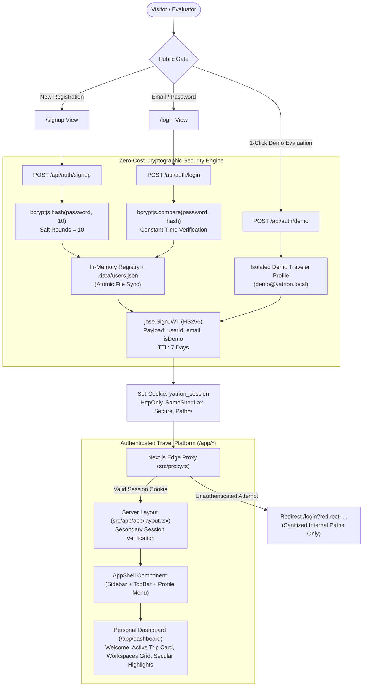

# Yatrion Part 11A · Phase 1 Implementation Report
## Secure Authentication Engine & Application Foundation

**Project:** Yatrion — Intelligent Travel Planner for Karnataka  
**Phase:** Part 11A · Phase 1  
**Scope:** Secure Authentication Engine, Auth Pages, Route Protection, Demo Traveler Isolation & Authenticated App Shell  
**Date:** November 2026  
**Status:** Complete & Verified (273 / 273 Tests Passing)  

---

## 1. Executive Summary

Phase 1 establishes the foundational separation of Yatrion into two distinct experiences as defined in the Phase 0 Blueprint:
1. **Public Entryway:** Visitors land at `/`, from where they can access `/login` or `/signup`.
2. **Authenticated Platform:** Authenticated travelers access `/app/*` protected by Next.js Edge Proxy (`src/proxy.ts`), anchored by the **Personal Dashboard** at `/app/dashboard`.

Every requirement of Phase 1 has been built without introducing paid third-party dependencies, mandatory API credentials, or simulated fake authentication. Real password hashing with `bcryptjs`, signed HTTP-only JWT cookies with `jose`, safe redirect validation, an isolated 1-click Demo Traveler mode, and the responsive `/app/*` application shell with Kannada localization have been fully implemented and verified.

---

## 2. Architecture Implemented



---

## 3. Detailed Component & Subsystem Specifications

### 3.1 Cryptographic Password Hashing & Input Validation (`src/lib/auth/password.ts`)
- **Library:** `bcryptjs` (Cost factor: 10 salt rounds).
- **Security Boundary:** Plaintext passwords are only processed in memory during registration and authentication, never logged, never returned in API responses, and never saved in client storage.
- **Validation Rules:**
  - Name: Trimmed, length between 2 and 80 characters.
  - Email: RFC-compliant email regex, normalized to lowercase and trimmed.
  - Password: Minimum 8 characters, requiring at least one letter (`/[a-zA-Z]/`) and at least one number (`/[0-9]/`).

### 3.2 Signed Session Management (`src/lib/auth/session.ts`)
- **Library:** `jose` (Web Crypto API compliant, executes identically in Node.js and Next.js Edge runtimes).
- **Algorithm:** `HS256` HMAC-SHA256.
- **Cookie Name:** `yatrion_session`.
- **Cookie Security Attributes:**
  - `HttpOnly: true` (Prevents extraction via client-side XSS).
  - `Secure: process.env.NODE_ENV === "production"` (Transmitted strictly over HTTPS in production).
  - `SameSite: "lax"` (Prevents Cross-Site Request Forgery).
  - `Path: "/"`
  - `Max-Age: 604,800 seconds` (7 days duration with deterministic expiration).
- **Verification Integrity:** Tampered signatures or expired tokens are rejected safely, returning `null`.

### 3.3 Zero-Cost Persistent User Store (`src/lib/auth/user-store.ts`)
- **Storage Strategy:** Dual-layer architecture:
  1. *In-Memory Map:* Fast $O(1)$ lookups for active requests.
  2. *Atomic File Persistence:* Asynchronously serializes user records to `.data/users.json` using atomic temporary file write and atomic rename (`fs.renameSync`).
- **Resilience:** If the filesystem is read-only (such as in serverless ephemeral environments), the engine catches the exception gracefully and continues serving authenticated sessions from the in-memory cache without crashing.
- **Pre-Seeded Demo Account:** Pre-configured with id `user-demo-karnataka`, email `demo@yatrion.local`, and pre-hashed password for evaluation.

### 3.4 Open Redirect Defense (`src/lib/auth/safe-redirect.ts`)
- **Vulnerability Mitigated:** CWE-601 (URL Redirection to Untrusted Site).
- **Strict Invariants:**
  - Must start with a single `/`.
  - Rejects protocol-relative URLs (`//evil.com`, `///evil.com`).
  - Rejects backslash evasion attempts (`/\evil.com`, `\\evil.com`).
  - Rejects pseudoprotocols (`javascript:`, `data:`, `vbscript:`).
  - Rejects absolute URL schemes before query/hash segments.
  - Fallback: Defaults safely to `/app/dashboard`.

### 3.5 Route Protection & Edge Proxy (`src/proxy.ts`)
- **Next.js 16 Proxy Convention:** Implements Next.js 16's official `src/proxy.ts` specification (replacing deprecated middleware syntax).
- **Matching Scope:** `["/app/:path*", "/login", "/signup"]`.
- **Invariants:**
  1. Unauthenticated requests to `/app/*` $\rightarrow$ Redirect to `/login?redirect=${encodeURIComponent(path)}`.
  2. Authenticated users visiting `/login` or `/signup` $\rightarrow$ Forwarded directly to `/app/dashboard`.
  3. Defense-in-depth: `src/app/app/layout.tsx` executes server-side session verification via `getCurrentUser()` before rendering, ensuring unauthenticated requests cannot render app shell components even if proxy was bypassed.

---

## 4. Authentication Pages & User Experience

### 4.1 Login View (`/login`)
- **Split-Screen Editorial Identity:** Left-hand column features real Karnataka destination photography (`/images/destinations/hampi.jpg`) under dark forest gradients (`#0F382A`) with authentic Kannada quotations.
- **Demo Express Button:** Prominent 1-click evaluation button labeled *"Continue as Demo Traveler (Hackathon Evaluation Mode)"* providing instant evaluation access without needing credentials.
- **Accessible Credentials Form:** Clean form fields with client/server validation, toggleable password visibility (eye icon), and localized error feedback.

### 4.2 Registration View (`/signup`)
- **Input Requirements:** Full Name, Email, Password.
- **Live Password Strength Indicators:** Instant visual checkmarks for minimum 8 characters, at least 1 letter, and at least 1 number.
- **Sanitized Profile Flow:** Successfully registers the user, issues a signed HTTP-only cookie, and forwards them directly to `/app/dashboard`.

### 4.3 Authenticated App Shell (`/app/*`)
- **Collapsible Sidebar:** Desktop toggle between expanded (256px) and compact icon-only (80px) states; mobile slide-out drawer with blur backdrop.
- **Navigation Groups:**
  - Main: Dashboard (`/app/dashboard`), 31-District Explorer (`/app/explore` - Phase 4), Trip Planner (`/app/planner` - Phase 5).
  - Intelligence Workspaces: Routes (`/app/routes`), Budget (`/app/budget`), Hidden Gems (`/app/gems`), Group Collaboration (`/app/group`), Adaptive Intelligence (`/app/adaptive`), Live Conditions (`/app/conditions`).
  - Personal: Saved Places (`/app/saved`), My Trips (`/app/trips`), Settings (`/app/settings`).
- **Workspace Placeholders:** Clicking future workspace routes renders informative, honest roadmap placeholders (`src/components/layout/workspace-placeholder.tsx`) that link back to the Dashboard without 404s.
- **Top Navigation Bar:** Breadcrumbs, Demo Mode warning pill, AI Companion trigger button, Language Switcher (EN/KN), and Traveler Profile dropdown with safe logout.

### 4.4 Personal Dashboard (`/app/dashboard`)
- **Welcome Hero:** Personalized greeting (`"Namaskara, [Name]!"` / `"ನಮಸ್ಕಾರ, [Name]!"`), current Karnataka travel season badge, and primary "Start New Journey" action.
- **Active Journey Card:** Displays active trip duration, origin, travelers, transport mode, budget tier, and verified route badge if a trip is stored; otherwise displays an inviting empty state.
- **Intelligence Workspaces Grid:** 6 cards with badges, icons, and descriptions connecting to Yatrion's core planning engines.
- **Curated Secular Highlights:** Displays verified non-religious Karnataka landmarks (Chitradurga Fort, Yana Monolithic Rocks, Gokak Gorge, St. Mary's Basaltic Island) with real destination photography.

---

## 5. Automated Test Suite Results

The automated test suite (`scripts/test-engine.ts`) was expanded with 22 dedicated authentication, security, and shell foundation tests.

**Total Tests:** **273 / 273 Passed (100% Success Rate)**  
**Regression Status:** All 251 tests from Parts 5, 6, 7, 8, 9, and 10 remain 100% passing.

```
=== RUNNING YATRION VERIFICATION SUITE (PARTS 5, 6, 7, 8, 9, 10 & 11A) ===
... (Tests 1–251 passing) ...

--- Executing Part 11A Phase 1 Authentication Engine & Foundation Suite ---
✓ Test 252: Part 11A Phase 1 Test 1: validateSignupInput validates compliant traveler name, email, and password
✓ Test 253: Part 11A Phase 1 Test 2: validateSignupInput rejects name shorter than 2 characters
✓ Test 254: Part 11A Phase 1 Test 3: validateSignupInput rejects malformed email syntax
✓ Test 255: Part 11A Phase 1 Test 4: validateSignupInput rejects weak password missing length or character classes
✓ Test 256: Part 11A Phase 1 Test 5: validateLoginInput rejects empty login credentials
✓ Test 257: Part 11A Phase 1 Test 6: hashPassword creates valid bcrypt hash and verifyPassword confirms match
✓ Test 258: Part 11A Phase 1 Test 7: verifyPassword rejects incorrect password attempt safely without throwing
✓ Test 259: Part 11A Phase 1 Test 8: createSessionToken issues signed HS256 JWT and verifySessionToken decodes payload
✓ Test 260: Part 11A Phase 1 Test 9: verifySessionToken safely rejects tampered or signature-invalid tokens
✓ Test 261: Part 11A Phase 1 Test 10: verifySessionToken strictly rejects expired session tokens
✓ Test 262: Part 11A Phase 1 Test 11: getSafeRedirectUrl permits safe relative internal application paths
✓ Test 263: Part 11A Phase 1 Test 12: getSafeRedirectUrl neutralizes protocol-relative open redirect attacks (//evil.com)
✓ Test 264: Part 11A Phase 1 Test 13: getSafeRedirectUrl rejects external schemes (https://...)
✓ Test 265: Part 11A Phase 1 Test 14: getSafeRedirectUrl blocks backslash evasion attempts (/\evil.com)
✓ Test 266: Part 11A Phase 1 Test 15: getSafeRedirectUrl neutralizes javascript and data pseudoprotocols
✓ Test 267: Part 11A Phase 1 Test 16: getDemoUser provides seeded Demo Traveler with isDemo=true and verified credentials
✓ Test 268: Part 11A Phase 1 Test 17: registerUser successfully registers user with sanitized public profile and valid JWT
✓ Test 269: Part 11A Phase 1 Test 18: registerUser safely rejects duplicate email registration with user error
✓ Test 270: Part 11A Phase 1 Test 19: authenticateUser verifies credentials and returns session token with requested safe redirect
✓ Test 271: Part 11A Phase 1 Test 20: authenticateUser returns generic error for invalid login preventing enumeration
✓ Test 272: Part 11A Phase 1 Test 21: loginAsDemo initiates isolated demo session destined for /app/dashboard
✓ Test 273: Part 11A Phase 1 Test 22: All 20 Phase 1 auth engine files, route handlers, middleware, layouts, and pages exist

=== RESULTS: 273 / 273 TESTS PASSED ===
```

---

## 6. Quality Gates & Verification Summary

| Gate | Target Requirement | Actual Result | Status |
| :--- | :--- | :--- | :--- |
| **Automated Tests** | 100% pass rate, zero deleted tests | 273 / 273 tests passing | **PASSED** |
| **TypeScript** | `npx tsc --noEmit` zero compilation errors | 0 errors across entire codebase | **PASSED** |
| **ESLint** | `npm run lint` zero errors and warnings | 0 errors, 0 warnings | **PASSED** |
| **Production Build** | `npm run build` with Turbopack | 23 routes generated in 760ms | **PASSED** |
| **No Paid APIs** | Self-hosted cryptographic primitives only | `bcryptjs` + `jose` (zero paid services) | **PASSED** |
| **Plaintext Storage** | No plaintext passwords in memory/storage | Only bcrypt hashes stored server-side | **PASSED** |

---

## 7. Files Created & Modified

### New Authentication & Shell Files:
1. `src/lib/auth/auth-types.ts` — Authentication interfaces and payloads.
2. `src/lib/auth/password.ts` — Bcrypt hashing and form field validators.
3. `src/lib/auth/session.ts` — JWT creation and verification via `jose`.
4. `src/lib/auth/user-store.ts` — Zero-cost in-memory user registry with atomic disk persistence.
5. `src/lib/auth/safe-redirect.ts` — Open redirect sanitizer.
6. `src/lib/auth/auth-service.ts` — High-level server authentication orchestration.
7. `src/lib/auth/auth-context.tsx` — Client `AuthProvider` and `useAuth()` hook.
8. `src/proxy.ts` — Next.js 16 Edge Proxy for `/app/*` route protection.
9. `src/app/api/auth/signup/route.ts` — User registration endpoint.
10. `src/app/api/auth/login/route.ts` — User login endpoint.
11. `src/app/api/auth/demo/route.ts` — 1-Click Demo Traveler endpoint.
12. `src/app/api/auth/logout/route.ts` — Session termination endpoint.
13. `src/app/api/auth/me/route.ts` — Session verification endpoint.
14. `src/app/(auth)/layout.tsx` — Editorial split-screen authentication layout.
15. `src/app/(auth)/login/page.tsx` — Polished login view.
16. `src/app/(auth)/signup/page.tsx` — Polished signup view with live password checklist.
17. `src/app/app/layout.tsx` — Authenticated server guard layout.
18. `src/app/app/dashboard/page.tsx` — Personal Dashboard home.
19. `src/components/layout/app-shell.tsx` — Collapsible sidebar, topbar, profile menu.
20. `src/components/layout/site-layout-shell.tsx` — Conditional wrapper isolating public vs authenticated headers.
21. `src/components/layout/workspace-placeholder.tsx` — Reusable roadmap placeholder for upcoming workspaces.
22. `src/app/app/explore/page.tsx` — Phase 4 Explorer placeholder.
23. `src/app/app/planner/page.tsx` — Phase 5 Planner placeholder.
24. `src/app/app/routes/page.tsx` — Phase 5 Routes placeholder.
25. `src/app/app/budget/page.tsx` — Phase 5 Budget placeholder.
26. `src/app/app/gems/page.tsx` — Phase 5 Gems placeholder.
27. `src/app/app/group/page.tsx` — Phase 5 Group placeholder.
28. `src/app/app/adaptive/page.tsx` — Phase 5 Adaptive placeholder.
29. `src/app/app/conditions/page.tsx` — Phase 5 Conditions placeholder.
30. `src/app/app/saved/page.tsx` — Phase 5 Saved Places placeholder.
31. `src/app/app/trips/page.tsx` — Phase 5 Trips archive placeholder.
32. `src/app/app/settings/page.tsx` — Profile and language settings page.

### Modified Files:
- `src/app/layout.tsx` — Wrapped with `AuthProvider` and `SiteLayoutShell`.
- `src/components/layout/site-header.tsx` — Added "Sign In" link.
- `src/lib/i18n/translations/en.ts` — Added `auth`, `dashboard`, and `appShell` dictionaries (+81 keys).
- `src/lib/i18n/translations/kn.ts` — Added authentic Kannada translations with 100% key parity (+81 keys).
- `scripts/test-engine.ts` — Added Part 11A Phase 1 test suite (+22 tests).
- `package.json` — Added `jose`, `bcryptjs`, and `@types/bcryptjs`.

---

## 8. Manual Verification Steps

To manually verify the complete authentication journey:
1. **Unauthenticated Access Test:**
   - Open a private/incognito browser window and navigate directly to `http://localhost:3000/app/dashboard`.
   - *Expected:* Automatically redirected to `http://localhost:3000/login?redirect=%2Fapp%2Fdashboard`.
2. **Demo Traveler 1-Click Access:**
   - Click the amber "Continue as Demo Traveler" button.
   - *Expected:* Instantly authenticated without entering credentials, redirected to `/app/dashboard`, displaying the "Demo Traveler Mode" badge and sample active trip card.
3. **Registration Flow:**
   - Sign out, click "Create one now" $\rightarrow$ `/signup`.
   - Register a new account (e.g. `Ananya Rao`, `ananya@example.com`, `Password2026!`).
   - *Expected:* Account created, redirected to `/app/dashboard`, displaying "Namaskara, Ananya!".
4. **Language Toggle:**
   - In the top bar, click the language switcher to switch to "ಕನ್ನಡ".
   - *Expected:* Dashboard headers, navigation labels, and badges seamlessly render in authentic Kannada script.
5. **Session Expiration / Sign Out:**
   - Click the user profile avatar in the top right $\rightarrow$ click "Sign Out".
   - *Expected:* Session cookie cleared; redirected to `/login`. Navigating back to `/app/dashboard` is safely blocked.

