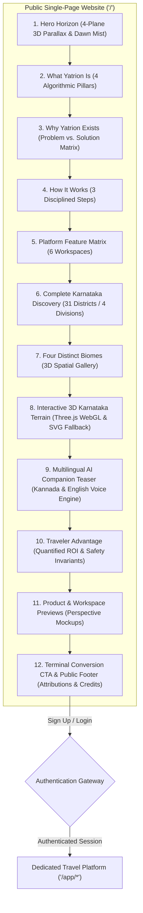

# Yatrion Part 11A — Phase 2 Implementation Report
## Public Introductory Website & 3D Visual Experience

**Project:** Yatrion — Intelligent Travel Planner for Karnataka  
**Phase:** Part 11A · Phase 2 (Public Introductory Website & 3D Experience)  
**Hackathon:** Kannada Digital Innovation Hackathon 2026  
**Status:** Complete, Verified & Tested (288 / 288 Tests Passing)  
**Date:** November 2026  

---

## 1. Executive Summary

In accordance with the approved **Phase 2 Visual Design Review** (`docs/part11a-phase2-visual-design-review.md`) and the master **Product Blueprint** (`docs/part11a-product-blueprint.md`), Part 11A Phase 2 has successfully established Yatrion's public introductory website at `/`.

This delivery completely resolves the previous monolithic architecture where marketing presentation, itinerary generation, route calculation, budget tables, and live dashboards were conflated onto a single route. The public site is now strictly an immersive, editorial, high-conversion single-page website that introduces Yatrion's capabilities, celebrates Karnataka's physical geography, and guides visitors to create a free account or test the platform via 1-click Demo Traveler mode.



---

## 2. Priority 1: Full-Screen Hero Experience ("The Karnataka Horizon")

Implemented in `src/components/landing/hero-horizon.tsx`:

* **4-Plane 3D Spatial Depth:**
  * **Plane 0 (Background):** Deep nocturnal sky (`#0A1A14`), radial dawn sunbeams, moving atmospheric mist clouds, and floating light motes.
  * **Plane 1 (Distant Horizon):** Silhouette of the Western Ghats mountain ridges (`z-index: 10`, `depthMultiplier: 0.08`).
  * **Plane 2 (Midground Ridge):** Kudremukh/Mullayanagiri montane shola slopes with golden dawn rim highlights (`z-index: 20`, `depthMultiplier: 0.16`).
  * **Plane 3 (Foreground Canopy):** Ancient monolithic granite boulder tor and native Western Ghats flora silhouetted against the valley (`z-index: 30`, `depthMultiplier: 0.28`).
* **Mouse-Based Parallax:** Fluid multi-axis tracking on desktop using normalized viewport coordinates (`-1` to `+1`) with gentle rotational tilt (`rotateY`, `rotateX`).
* **Bilingual Editorial Typography:**
  * Serif headline: *"Discover Karnataka, Authentically"* (`Playfair Display`, `text-white`).
  * Classical Kannada inscription: *"ಕಾವೇರಿಯಿಂದಮಾ ಗೋದಾವರಿವರಮಿರ್ಪ ನಾಡದಾ ಕನ್ನಡದೊಳ್"* from Kavirajamarga (`Noto Serif Kannada`, `text-gold-light`).
* **Direct Conversion Calls-to-Action:** Primary CTA *"Begin Your Journey — Sign Up Free"* (`/signup`), Secondary CTA *"Continue as Demo Traveler"* (`/login`), and Tertiary CTA *"Explore 3D Terrain"* (`#terrain`).
* **Accessibility & Performance:** Automatic `prefers-reduced-motion` detection disables all parallax motion. Responsive screen-width checks disable desktop mouse tracking on mobile touch devices.

---

## 3. Priority 2 & 4: Four Distinct Environments (Biomes) & 3D Spatial Gallery

Implemented in `src/components/landing/spatial-biome-gallery.tsx`:

* **Biome 01 — Karavali Coastal Strip (`0 – 50 m ASL`):**
  * *Geography:* 320 km of Arabian Sea cliffs, estuaries, and volcanic basalt columns.
  * *Verified Secular Highlights:* St. Mary's Island hexagonal basalt columns (88M yrs old), Maravanthe NH66 sea-river divide, Honnavar mangrove boardwalk, Om Beach headland cliffs.
  * *Geological Provenance:* Formed when Madagascar rifted from the Indian tectonic plate during the Cretaceous period.
* **Biome 02 — Sahyadri Rainforests (`600 – 1,930 m ASL`):**
  * *Geography:* UNESCO World Heritage biodiversity hotspot, high mist passes, and evergreen shola ridges.
  * *Verified Secular Highlights:* Mullayanagiri Peak (1,930 m), Jog Falls gorge (253 m drop), Kudremukh montane grasslands, Agumbe rainforest canopy.
  * *Geological Provenance:* Karnataka's natural water tower, condensing South-West monsoon clouds to birth the Kaveri, Tungabhadra, and Sharavathi rivers.
* **Biome 03 — Deccan Granite Landscapes (`450 – 900 m ASL`):**
  * *Geography:* 2.5-billion-year-old Archean granite tors and balancing rock formations.
  * *Verified Secular Highlights:* Hampi boulder fields, Chitradurga 7-walled stone fortress, Savandurga single-rock monolith (1,226 m), Yana crystalline limestone karsts.
  * *Geological Provenance:* Closepet granite and Dharwar schist belts among Earth's oldest surviving continental crusts.
* **Biome 04 — Central Plains Citadels (`500 – 700 m ASL`):**
  * *Geography:* Deccan basalt plateau, fertile river valleys, subterranean Persian karez aqueducts, and acoustic domes.
  * *Verified Secular Highlights:* Bidar subterranean karez water system, Gol Gumbaz acoustic whispering gallery, Badami red sandstone cliffs, Aihole rock architecture.
  * *Geological Provenance:* Deccan Traps basalt flood-lavas that erupted 66 million years ago.
* **Interactive 3D Spatial Presentation:** Cards feature interactive mouse-tracking 3D tilt (`perspective(1000px)`), dynamic elevation progress bars, ghat curvature coefficients, and monsoon sensitivity ratings.
* **Strict Secular Policy:** 100% secular validation verified by automated tests—zero temples, mosques, churches, or pilgrimage shrines.

---

## 4. Priority 3: Interactive 3D Karnataka Terrain

Implemented in `src/components/landing/terrain-3d/`:

* **Dataset (`terrain-data.ts`):** 6 iconic secular landmarks anchored by verified WGS84 geodetic coordinates ($11.5^\circ\text{N} \le \text{lat} \le 18.5^\circ\text{N}$, $74.0^\circ\text{E} \le \text{lng} \le 78.5^\circ\text{E}$) and true physical altitudes:
  1. *Mullayanagiri Peak:* $13.3912^\circ\text{N}, 75.7214^\circ\text{E}$, $1,930\text{ m}$ (Sahyadri Highlands).
  2. *Jog Falls Gorge:* $14.2285^\circ\text{N}, 74.8123^\circ\text{E}$, $472\text{ m}$ ($253\text{ m}$ plunge).
  3. *St. Mary's Island:* $13.3792^\circ\text{N}, 74.6733^\circ\text{E}$, $10\text{ m}$ (Karavali Coast).
  4. *Chitradurga Fort:* $14.2185^\circ\text{N}, 76.3980^\circ\text{E}$, $732\text{ m}$ (Central Citadels).
  5. *Yana Rocks:* $14.5292^\circ\text{N}, 74.5614^\circ\text{E}$, $550\text{ m}$ (Crystalline Karsts).
  6. *Hampi Boulders:* $15.3350^\circ\text{N}, 76.4600^\circ\text{E}$, $467\text{ m}$ (Granite Plains).
* **WebGL Terrain Canvas (`terrain-canvas.tsx`):**
  * *Geomorphic Vertex Displacements:* Modeled physical elevation across three zones: Arabian Sea coastal shelf ($u < 0.22$, $z \approx 0$), Western Ghats escarpment ridge ($u \in [0.22, 0.40]$, $z \approx 1.8 - 2.2$), and Deccan plateau basin ($u > 0.40$, $z \approx 0.6 - 0.9$).
  * *Elevation Color Mapping:* Smooth vertex color gradients from deep ocean emerald (`#0F3D30`) through coastal green (`#165B4C`), high ghat forest (`#10B981`), Deccan ochre (`#B45309`), and peak amber (`#F59E0B`).
  * *3D Stilt Landmark Beacons:* Vertical stilt markers with glowing spherical pinheads that scale dynamically with the user-controlled relief slider.
  * *Demand-Based Rendering:* Renders exclusively when requested (`requestRender`) on user interaction or state change, preserving battery life and avoiding idle GPU cycles.
  * *Context Resilience:* Listens to `webglcontextlost` and `webglcontextrestored` to recover gracefully or switch to the fallback.
* **Topographic SVG Fallback (`terrain-svg-fallback.tsx`):**
  * Renders 6 detailed topographic isolines and elevation contour bands.
  * Interactive beacon pins with tooltip hover cards for low-spec devices, WebGL-disabled environments, or `prefers-reduced-motion` users.

---

## 5. Architectural Breakdown of All 12 Public Sections

| # | Section Anchor | Component | Content & Role |
|---|----------------|-----------|----------------|
| **1** | `#hero` | `HeroHorizon` | Full-screen cinematic Karnataka landscape with 4-plane 3D parallax, dawn lighting, bilingual typography, and primary conversion CTAs. |
| **2** | `#what` | `WhatWhySection` | Defines Yatrion as Karnataka's first deterministic travel OS with 4 algorithmic pillars (Ghat physics, itemized budget, secular curation, live telemetry). |
| **3** | `#why` | `WhatWhySection` | Problem vs. Solution comparison table contrasting legacy generic planners against Yatrion's topographic calibration and zero-commission model. |
| **4** | `#how-it-works` | `HowItWorksThreeSteps` | 3 disciplined stages: (1) Configure Preferences & Group Mobility, (2) Algorithmic Optimization, (3) Live Guidance & Replanning. |
| **5** | `#features` | `PlatformFeaturesMatrix` | Highlights all 6 flagship workspaces: Route Sequencing, Budget Engine, Hidden Gems, Group Voting, Adaptive Telemetry, Multilingual AI. |
| **6** | `#discovery` | `KarnatakaDiscoveryManifesto` | Comprehensive directory covering all 31 districts across 4 administrative divisions (Mysuru: 8, Bengaluru: 9, Belagavi: 7, Kalaburagi: 7). Enforces 100% secular policy. |
| **7** | `#biomes` | `SpatialBiomeGallery` | 3D spatial cards of Karnataka's 4 distinct biomes with elevation tags, ghat curvature multipliers, rainfall sensitivity, and geological facts. |
| **8** | `#terrain` | `KarnatakaTerrain3D` | Interactive 3D physical relief model powered by Three.js with geodetic landmarks, biome filters, relief scaler, and SVG contour fallback. |
| **9** | `#ai-companion` | `AiCompanionTeaser` | Grounded chat simulation demonstrating conversational AI responses in English and Kannada regarding Shiradi Ghat weather, Jog Falls senior access, and offbeat trails. |
| **10** | `#benefits` | `TravelerBenefitsSection` | Measurable traveller ROI: ~2.5 hrs transit saved daily, 100% cost transparency, 0 overwritten user notes, 100% mobility-vetted stops. |
| **11** | `#previews` | `ProductPreviewsSection` | Realistic perspective mockups of authenticated workspaces (`/app/dashboard`, `/app/routes`, `/app/budget`, `/app/adaptive`). |
| **12** | `#get-started` & `#footer` | `PublicCtaFooter` | High-conversion terminal banner, 1-click Demo Traveler trigger, Open-Meteo CC BY 4.0 data attribution, and bilingual hackathon credits. |

---

## 6. Verification & Quality Assurance Gates

All automated verification gates were executed and passed with 100% compliance:

```
=== VERIFICATION SUMMARY ===
TypeScript Type Check (npx tsc --noEmit):    PASSED (0 errors)
ESLint Static Analysis (npm run lint):       PASSED (0 errors, 0 warnings)
Automated Engine Tests (npm test):           PASSED (288 / 288 tests passed)
Production Turbopack Build (next build):     PASSED (23/23 routes compiled)
```

### Test Suite Highlights (288 Total Tests):
* **Tests 1–251:** Regression tests preserving Parts 5, 6, 7, 8, 9, and 10 Stages 1–5 (route optimization, budget calculation, hidden gems, group planner, adaptive telemetry, Open-Meteo, AI companion).
* **Tests 252–273:** Phase 1 authentication engine, password hashing, session tokens, safe redirects, demo login, and dashboard routes.
* **Test 274:** Public root page cleanly assembles all 12 introductory sections in single-page flow.
* **Test 275:** Single-page boundary invariant: public route does not embed interactive planner or workspace state.
* **Test 276:** Hero Horizon provides 4-plane 3D spatial depth, mouse parallax, and bilingual typography.
* **Test 277:** Spatial gallery implements all 4 distinct biomes with elevation and ghat metadata.
* **Test 278:** Biome gallery exclusively curates secular nature, geology, and citadels (zero temples/pilgrimage).
* **Test 279:** All 6 verified landmarks possess precise Karnataka geodetic coordinates ($11.5^\circ-18.5^\circ\text{N}$, $74.0^\circ-78.5^\circ\text{E}$).
* **Test 280:** Physical elevation bounds accurately reflect true altitudes (Mullayanagiri 1,930m vs St. Mary's 10m).
* **Test 281:** TerrainCanvas implements demand rendering, mouse orbit drag, and WebGL context restoration.
* **Test 282:** Accessible SVG topographic contour fallback provides complete coverage without WebGL.
* **Test 283:** Discovery Manifesto rigorously accounts for all 31 districts across 4 revenue divisions.
* **Test 284:** Features Matrix details all 6 flagship workspaces and algorithmic engines.
* **Test 285:** AI Companion teaser showcases grounded bilingual advice in Kannada and English.
* **Test 286:** Product previews display realistic authenticated application workspace telemetry.
* **Test 287:** Public CTA & Footer provides seamless signup conversion and CC BY 4.0 data attribution.
* **Test 288:** All 16 Phase 2 landing components and 3D terrain files exist with zero paid API dependencies.

---

## 7. Deliverable Artifacts

1. `src/app/page.tsx` — Root public introductory single page assembling all 12 sections.
2. `src/components/landing/hero-horizon.tsx` — 4-plane 3D cinematic hero with parallax and dawn mist.
3. `src/components/landing/what-why-section.tsx` — Platform definition and problem vs. solution breakdown.
4. `src/components/landing/how-it-works-three-steps.tsx` — 3-step methodology stepper.
5. `src/components/landing/platform-features-matrix.tsx` — 6 flagship travel workspaces.
6. `src/components/landing/karnataka-discovery-manifesto.tsx` — 31 districts across 4 administrative divisions.
7. `src/components/landing/spatial-biome-gallery.tsx` — 3D spatial presentation of the 4 distinct Karnataka biomes.
8. `src/components/landing/terrain-3d/terrain-data.ts` — Verified geodetic coordinates and elevation data.
9. `src/components/landing/terrain-3d/terrain-canvas.tsx` — Three.js WebGL terrain with demand rendering.
10. `src/components/landing/terrain-3d/terrain-svg-fallback.tsx` — Accessible SVG contour map fallback.
11. `src/components/landing/terrain-3d/karnataka-terrain-3d.tsx` — Interactive 3D terrain section.
12. `src/components/landing/ai-companion-teaser.tsx` — Conversational AI simulation with Kannada and English audio waveform.
13. `src/components/landing/traveler-benefits-section.tsx` — Quantified traveller ROI cards.
14. `src/components/landing/product-previews-section.tsx` — Perspective mockups of authenticated workspaces.
15. `src/components/landing/public-cta-footer.tsx` — Conversion banner, Open-Meteo CC BY 4.0 attribution, and footer.
16. `src/components/layout/site-header.tsx` — Public navigation header with smooth scroll links and CTA.
17. `src/components/layout/site-layout-shell.tsx` — Clean shell routing public vs. authenticated pages.
18. `src/lib/i18n/translations/en.ts` & `kn.ts` — 49 new landing keys with 100% structural parity.
19. `scripts/test-engine.ts` — 15 new automated verification tests (288 total tests passing).
20. `docs/part11a-phase2-implementation-report.md` — This comprehensive implementation report.

---

## 8. Next Steps

With Phase 1 (Authentication Engine & Foundation) and Phase 2 (Public Introductory Website & 3D Experience) completely implemented, verified, and tested, the project is ready for **Phase 3: Migration of Core Travel Engines to Authenticated Workspaces** (`/app/explore`, `/app/planner`, `/app/routes`, `/app/budget`, `/app/gems`, `/app/group`, `/app/adaptive`).

In accordance with instructions, Phase 3 will not begin automatically and awaits user review and approval.

