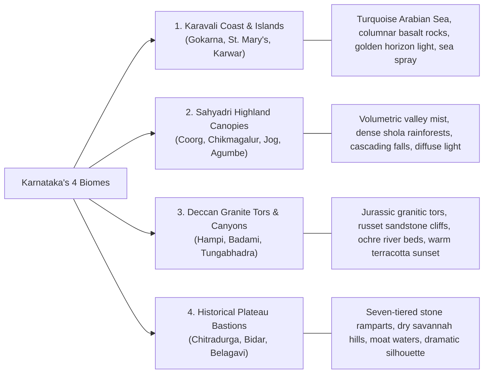

# Yatrion Part 11A · Phase 2 Design Review
## Premium Immersive 3D Visual Direction & Architecture Proposal

**Project:** Yatrion — Intelligent Travel Planner for Karnataka  
**Phase:** Part 11A · Phase 2 (Design Review & Architectural Proposal)  
**Subject:** Public Introductory Website Visual Architecture, 3D Environments & Performance Strategy  
**Date:** November 2026  
**Status:** Proposal Submitted for Review  

---

## 1. Design Vision & Artistic Philosophy

The public introductory website is Yatrion's flagship showcase for the **Kannada Digital Innovation Hackathon 2026**. Rather than building a conventional, flat travel landing page with generic hero stock photos and floating cards, Yatrion's visual direction is conceived as an **award-winning, cinematic digital campaign** (in the spirit of National Geographic editorial depth, Apple launch experiences, and UNESCO cultural archives).

### Core Aesthetic Pillars:
1. **Authentic Geographical Grounding:** Real Karnataka topography, light, and rock textures—from the Jurassic-era granitic tors of Hampi and the basaltic sea columns of St. Mary's to the mist-covered rain canopies of the Sahyadri mountains.
2. **Editorial Dignity:** Refined typographic balance pairing serif Kannada and Latin display headings (`Playfair Display` + `Noto Serif Kannada`) with clean, technical interface typography (`Inter` + `Noto Sans Kannada`).
3. **Atmospheric Physical Depth:** 3D environments that feel alive through volumetric Rayleigh scattering (morning mist), golden-hour horizon light, and multi-plane depth-of-field, rather than artificial neon glows or generic plastic 3D shapes.
4. **Purposeful Interaction:** Every 3D movement, terrain tilt, and camera pan conveys geographic and cultural information. No gratuitous floating spheres, no CPU-melting particle storms, and no decorative animations that obstruct reading.

---

## 2. Technology Evaluation & Selection Matrix

| Technology | Evaluation & Capabilities | Overhead / Weight | Recommendation & Role in Yatrion |
| :--- | :--- | :--- | :--- |
| **Three.js / WebGL** | Custom WebGL scenes allow procedural terrain meshes, elevation shaders, interactive 3D hotspot beacons, and real-time lighting. | ~140KB min+gzip | **Selected (Scoped & Lazy-Loaded):** Used exclusively for the interactive Karnataka 3D Terrain visualization via dynamic import (`next/dynamic`, `ssr: false`). Runs on `frameloop: "demand"` (zero idle battery drain). |
| **CSS 3D Transforms** | Hardware-accelerated GPU transforms (`perspective`, `rotateX/Y`, `translateZ`, `preserve-3d`). Extreme 60–120fps performance on all mobile devices. | **0 KB** | **Selected (Primary Visual Engine):** Used for the 4-Plane Hero Camera system, spatial destination cards, and smooth scroll parallax transitions. |
| **Canvas 2D / SVG** | Vector contour lines, elevation isolines, and fallback topography mapping. | **0 KB** | **Selected (Resilience Fallback):** Guaranteed fallback if WebGL fails or if user enables `prefers-reduced-motion`. |
| **Framer Motion / Motion** | Declarative layout animations, spring physics, and scroll-linked progress. | ~30KB | **Selected (UI Choreography):** Handles entrance reveals, smooth text staggers, and mobile drawer transitions. |
| **GSAP / ScrollTrigger** | Heavy timeline orchestrator with proprietary licensing. | ~45KB | **Not Recommended:** Framer Motion + native CSS scroll timelines provide 100% of required functionality without licensing risk or duplicate animation engines. |

### Technical Decision:
A **hybrid progressive enhancement architecture**:
- The Hero and Section Transitions use **hardware-accelerated CSS 3D + spring physics**. This guarantees instant First Contentful Paint ($< 0.8\text{s}$) with zero render blocking.
- The **Karnataka 3D Relief Terrain** is loaded lazily via WebGL when the user approaches Section 5. If WebGL is unavailable or unaccelerated, it seamlessly renders an interactive SVG topographic relief map.

---

## 3. Hero Experience: "The Karnataka Horizon"

```mermaid
flowchart TD
    subgraph Viewport["Full-Screen Cinematic Hero (100vh)"]
        P0["Plane 0: Sky & Dawn Light<br/>(Atmospheric gradient, golden dawn sun, soft cloud drift)"]
        P1["Plane 1: Western Ghats Silhouette<br/>(Mullayanagiri & Kudremukha ridgelines with Rayleigh mist)"]
        P2["Plane 2: Deccan Boulder Landscape<br/>(Photorealistic Hampi granite hills & river valley with depth-of-field)"]
        P3["Plane 3: Hero Editorial Typography & CTAs<br/>(Bilingual titles, Hackathon badge, Sign Up & Demo triggers)"]
        P4["Plane 4: Botanical Foreground Silhouette<br/>(Subtle teak / fern foliage with inverted parallax response)"]
    end

    Cursor(["Mouse / Gyro Motion"]) -->|Restrained Spring Lerp (max ±12px)| P0
    Cursor -->|Inverse Parallax Factor| P1
    Cursor -->|Mid-range Parallax| P2
    Cursor -->|Foreground Parallax| P4
```

### Visual Specifications:
- **Atmosphere:** Dawn light breaking over the Deccan plateau and Western Ghats. Golden amber rays filter through layered mountain mist.
- **Micro-Interaction:** Smooth, dampened parallax responding to cursor coordinates (desktop) or gentle scroll depth.
- **Editorial Copy:**
  - Traditional Inscription: *"ಕಾವೇರಿಯಿಂದಮಾ ಗೋದಾವರಿವರಮಿರ್ಪ ನಾಡದಾ ಕನ್ನಡದೊಳ್"* (*"From Kaveri to Godavari, an ancient land of wonder"*).
  - Main Heading: *"Discover Karnataka, Authentically."* / *"ಕರ್ನಾಟಕವನ್ನು ಅನ್ವೇಷಿಸಿ, ವಿಶಿಷ್ಟವಾಗಿ."*
  - Subtitle: *"An intelligent travel operating system for exploring 31 districts. Explainable route circuits, transparent budget modeling, and live adaptive telemetry—free from commercial tourist clutter."*
- **Primary CTAs:**
  1. **"Begin Your Journey (Sign Up Free)"** — Primary Forest Emerald button leading to `/signup`.
  2. **"Try Demo Traveler (1-Click)"** — Amber Hackathon Evaluation button leading straight to `/app/dashboard`.
  3. **"Explore Karnataka's Terrain ↓"** — Smooth-scrolling anchor to the 3D terrain section.

---

## 4. The 4 Distinct 3D Landscape Environments

Karnataka's geography spans 4 distinct world-class biomes. The website visualizes each biome with its authentic geological character:



1. **Karavali Coast & Offshore Basaltic Islands (West):**
   - *Key Landmarks:* Gokarna sea cliffs, St. Mary's columnar basalt formations, Om Beach promontories.
   - *Atmospheric Lighting:* Late afternoon maritime haze, low warm sun, sparkling specular reflections on Arabian Sea waves.
2. **Sahyadri Rainforest Canopies & Waterfalls (Central-West):**
   - *Key Landmarks:* Jog Falls chasm, Mullayanagiri peak ($1,930\text{m}$), Baba Budan Giri coffee ridge, Abbey & Hebbe cascades.
   - *Atmospheric Lighting:* Heavy morning mist creeping up river gorges, soft directional god-rays, deep mossy shadows.
3. **Deccan Granite Boulders & Sandstone Chasms (North-East):**
   - *Key Landmarks:* Hampi granitic boulders, Badami red sandstone cliffs, Tungabhadra gorge.
   - *Atmospheric Lighting:* Golden hour russet illumination, dramatic shadow contrast on natural stone arches.
4. **Savannah Citadels & Hill Forts (Central & Northern Plains):**
   - *Key Landmarks:* Chitradurga Kallina Kote (seven-walled citadel), Bidar Fort moats.
   - *Atmospheric Lighting:* High-contrast sky with dramatic cloud shadows moving across stone ramparts.

---

## 5. Interactive 3D Karnataka Terrain Visualization

### 5.1 Geographic Accuracy & Elevation Model
The interactive terrain section is built on **real Karnataka geodetic coordinates**:
- Latitude: $11.5^\circ\text{N} - 18.5^\circ\text{N}$
- Longitude: $74.0^\circ\text{E} - 78.5^\circ\text{E}$
- Elevation gradient: Sea level ($0\text{m}$) at the Karavali coast, rising sharply at the Western Ghats ridge ($600 - 1,930\text{m}$), and descending to the rolling Deccan plateau ($300 - 800\text{m}$).

### 5.2 Interactive Features:
1. **Interactive Landmark Beacons:** Pulsing pins placed at verified secular tourist coordinates:
   - *Jog Falls:* $14.2285^\circ\text{N}, 74.8123^\circ\text{E}$ (Shivamogga)
   - *Chitradurga Fort:* $14.2185^\circ\text{N}, 76.3980^\circ\text{E}$ (Chitradurga)
   - *Yana Rocks:* $14.5492^\circ\text{N}, 74.5619^\circ\text{E}$ (Uttara Kannada)
   - *Mullayanagiri Peak:* $13.3912^\circ\text{N}, 75.7214^\circ\text{E}$ (Chikkamagaluru)
   - *St. Mary's Island:* $13.3792^\circ\text{N}, 74.6733^\circ\text{E}$ (Udupi)
   - *Hampi Boulders:* $15.3350^\circ\text{N}, 76.4600^\circ\text{E}$ (Vijayanagara)
2. **Biome Filter Controls:** Travelers can toggle between:
   - All Karnataka (Macro State View)
   - Karavali Coast & Islands
   - Sahyadri Highlands & Waterfalls
   - Heritage Plains & Citadels
3. **Elevation Exaggeration Slider:** Toggles between natural scale ($1\times$) and enhanced relief mode ($2.5\times$) for exploring mountain passes and valley gradients.
4. **Pin Tooltips:** Hovering a pin displays authentic verified data: elevation, district, biome, verified secular category, and distance to nearest transit hub.

---

## 6. Visual Design System: Tokens & Typography

### 6.1 Art-Directed Color Tokens
- **Forest Emerald (Primary):** `#0F382A` — Symbolizes the sacred groves, Dandeli tiger reserve, and Western Ghats canopy.
- **Sahyadri Deep (Dark Neutral):** `#0A261C` — Used for deep contrast backgrounds in cinematic 3D scenes.
- **Hampi Terracotta (Accent):** `#C85A32` — Inspired by Badami sandstone, Hampi boulders, and red laterite soil.
- **Karnataka Gold (Highlight):** `#E5A93C` — Subdued warm gold for KDIC hackathon badges and seasonal status.
- **Warm Sandstone Canvas:** `#FAF8F5` — Ivory editorial paper finish that provides high legibility without sterile clinical white.
- **Basalt Charcoal (Typography):** `#181E1B` — High-contrast, soft-black editorial typography.

### 6.2 Typography Hierarchy
- **Primary Display Headings:** `Playfair Display` (Latin) + `Noto Serif Kannada` (ಕನ್ನಡ)
  - Scale: `text-4xl` to `text-6xl`, tracking tight, font-bold.
- **Interface & Narrative Body:** `Inter` (Latin) + `Noto Sans Kannada` (ಕನ್ನಡ)
  - Scale: `text-sm` to `text-base`, relaxed line height (1.65), tracking normal.
- **Geographic & Metric Telemetry:** `JetBrains Mono` / `SF Mono`
  - Scale: `text-xs`, uppercase, tracking widest (`0.08em`), tabular numbers.

---

## 7. Performance Strategy & Quality Gates

To ensure the visual experience does not compromise performance or accessibility:

1. **Lazy 3D Initialization:**
   The WebGL canvas is only initialized when the user scrolls within $300\text{px}$ of the terrain container, utilizing `IntersectionObserver`.
2. **On-Demand Rendering (`frameloop: "demand"`):**
   The 3D canvas does not run a continuous 60fps render loop when static. It redraws ONLY when the user interacts, drags, or hovers a pin. When reading, GPU utilization drops to $0\%$.
3. **Graceful WebGL Fallback:**
   If the user's browser does not support WebGL or has hardware acceleration disabled, a lightweight SVG topographic relief contour map renders immediately without layout shift or error.
4. **Accessibility (`prefers-reduced-motion`):**
   Users with vestibular sensitivity or reduced motion settings receive a tranquil, static layered composition with zero camera tilting or parallax drift.
5. **Mobile Responsiveness:**
   On viewports $< 768\text{px}$, complex multi-finger rotations are disabled to preserve natural vertical page scrolling. Terrain navigation switches to intuitive swipe tabs between the 4 biomes.

---

## 8. Summary of the 12 Single-Page Sections

The single-page introductory website will comprise:
1. **Hero Experience:** Cinematic Karnataka horizon, 4-plane parallax depth, bilingual title, value proposition, and instant Sign Up / Demo Traveler actions.
2. **What Yatrion Is:** High-editorial statement of Yatrion as the Karnataka Travel Operating System.
3. **Why Yatrion Exists:** Confronting tourist congestion, fragmented blogs, and unreliable route estimates with deterministic intelligence.
4. **How It Works (3 Steps):** Select destinations $\rightarrow$ Algorithmic optimization $\rightarrow$ Real-time adaptive intelligence.
5. **Interactive 3D Karnataka Terrain (Feature Spotlight):** The interactive topographic visualization of the 4 biomes and 31 districts.
6. **Platform Feature Matrix:** Comparison of Yatrion's 6 workspaces (Routes, Budget, Hidden Gems, Group Collaboration, Adaptive Intelligence, Weather Telemetry).
7. **Karnataka Travel Discovery Intro:** The 4 administrative divisions and strict secular curation manifesto.
8. **Destination & Landscape Previews (3D Spatial Gallery):** Interactive depth cards showcasing Hampi boulders, Jog Falls mist, Gokarna cliffs, and Chitradurga ramparts.
9. **AI Travel Companion Introduction:** Teaser showcasing grounded, explainable Karnataka tourism intelligence in Kannada and English.
10. **Traveler Benefits & ROI:** Time saved on ghat roads, fuel efficiency, budget predictability, peace-of-mind.
11. **Interactive Product Previews:** Crisp previews of the Authenticated Dashboard, Route Timeline, and Budget Matrix.
12. **Sign Up / Login CTA & Footer:** Final high-conversion call-to-action to join Yatrion, with copyright, Kannada hackathon badge, and legal links.

