# Yatrion Part 11A — Phase 3: Core Travel Engine Audit
## Migration Map & Authenticated Platform Architecture

**Project:** Yatrion — Intelligent Travel Planner for Karnataka  
**Document:** Core Travel Engine Audit & Workspace Migration Map  
**Phase:** Part 11A · Phase 3 (Authenticated Platform Implementation)  
**Date:** November 2026  
**Status:** Approved for Implementation  

---

## 1. Executive Summary

This audit establishes the migration blueprint for transitioning Yatrion from its legacy monolithic prototype to a secure, multi-page, authenticated travel platform. Across Parts 1 through 10, eight deterministic travel intelligence engines were built and rigorously verified by 288 automated tests.

In Phase 3, these engines are decoupled from the public marketing shell and integrated into **11 dedicated authenticated workspaces** located under the Next.js App Router path segment `/app/*`. Each workspace maintains strict data isolation, zero-cost architecture, secular heritage curation, and explainable decision provenance.

```mermaid
flowchart TD
    subgraph AuthPlatform["Authenticated Travel Platform ('/app/*')"]
        Dash["/app/dashboard<br/>Personal Command Center"]
        Explore["/app/explore<br/>31-District Secular Explorer"]
        Planner["/app/planner<br/>Smart Trip Planner"]
        Routes["/app/routes<br/>Route Optimization"]
        Budget["/app/budget<br/>Intelligent Budget Optimizer"]
        Gems["/app/gems<br/>Hidden Gems Discovery"]
        Group["/app/group<br/>Group Collaboration & Expenses"]
        Adaptive["/app/adaptive<br/>Adaptive Command Center"]
        Conditions["/app/conditions<br/>Weather & Road Telemetry"]
        Saved["/app/saved<br/>Saved Places & Gems"]
        Trips["/app/trips<br/>My Trips & Archive"]
        Settings["/app/settings<br/>Preferences & Language"]
    end

    subgraph CoreEngines["Deterministic Core Engines (src/lib/)"]
        E1["Itinerary Engine<br/>(itinerary-engine.ts)"]
        E2["Route Optimizer<br/>(routes/route-optimizer.ts)"]
        E3["Budget Engine<br/>(budget/budget-optimizer.ts)"]
        E4["Discovery Engine<br/>(discovery/discovery-engine.ts)"]
        E5["Group Engine<br/>(group/group-expenses.ts)"]
        E6["Adaptive Engine<br/>(adaptive/issue-detector.ts)"]
        E7["Telemetry Engine<br/>(adaptive/providers/weather-provider.ts)"]
        E8["AI Companion<br/>(assistant/knowledge-engine.ts)"]
    end

    E1 --> Planner & Trips & Dash
    E2 --> Routes & Dash
    E3 --> Budget & Dash
    E4 --> Gems & Explore & Saved
    E5 --> Group
    E6 --> Adaptive & Dash
    E7 --> Conditions & Adaptive
    E8 -.-> AuthPlatform
```



---

## 2. Comprehensive Engine Audit & Workspace Mapping

### 2.1 Engine 1: Smart Trip Planner & Itinerary Engine
* **Source Modules:**
  * Logic: `src/lib/itinerary-engine.ts`, `src/lib/planner-types.ts`
  * UI Components: `src/components/planner/smart-trip-planner.tsx`, `src/components/planner/generated-itinerary.tsx`, `src/components/planner/trip-preferences-summary.tsx`
  * Persistence & Export: `src/lib/trip-storage.ts`, `src/lib/trip-export.ts`
* **Target Workspace:** `/app/planner` (Active Trip Planner) and `/app/trips` (Trip Archive & Management).
* **Business Capabilities:**
  * Deterministic scoring of Karnataka destinations against interest vectors (`scoreDestination`).
  * 3 daily time slots (morning, afternoon, evening) with rest/pacing guidance.
  * Interactive itinerary customization: stop deletion, reordering, activity note-taking, day note-taking, and stop completion toggles.
  * Formatted bilingual text export (English and Kannada Unicode) and print stylesheet formatting.
* **Shared State & Data Ownership:**
  * Owns: `TripPreferences`, `GeneratedItinerary`, `ItineraryDay[]`, `dayNotes`, `stopNotes`, `completedStopKeys`.
  * Exports to: Route optimizer (`ItineraryDay[]`), budget calculator, adaptive context (`UnifiedTripIntelligenceContext`).
* **Existing Test Coverage:** Tests 1–14, Tests 18–26, Tests 40–43 (Part 5 & 6).
* **Migration Action:** Mount the full `SmartTripPlanner` and `GeneratedItinerary` in `/app/planner`, backed by user-scoped storage so trips are tied directly to authenticated user IDs.

---

### 2.2 Engine 2: Topographic Route Optimization Engine
* **Source Modules:**
  * Logic: `src/lib/routes/route-optimizer.ts`, `src/lib/routes/route-estimates.ts`, `src/lib/routes/route-feasibility.ts`, `src/lib/routes/route-types.ts`
  * UI Components: `src/components/routes/route-overview.tsx`, `src/components/routes/daily-route-timeline.tsx`, `src/components/routes/route-stop-card.tsx`
* **Target Workspace:** `/app/routes`.
* **Business Capabilities:**
  * Deterministic nearest-neighbor TSP variant sequencing daily destinations to eliminate backtracking.
  * Topographic distance estimation using Haversine with Western Ghats winding penalties ($1.35\times-1.55\times$).
  * Mountain driving speed calibration ($30-40\text{ km/h}$) and daylight arrival cutoff checks ($18:00\text{ IST}$).
  * Catalog of 40 verified attraction coordinates (`KARNATAKA_ATTRACTIONS`).
  * External Google Maps navigation intent links.
  * Clear provenance labeling distinguishing deterministic estimates from live GPS navigation.
* **Shared State & Data Ownership:**
  * Consumes: `ItineraryDay[]` and `TripPreferences` from the active trip.
  * Produces: `OptimizedRoutePlan` stored in `StoredTripState.optimizedRoute`.
* **Existing Test Coverage:** Tests 83–112 (Part 10 Stage 1).
* **Migration Action:** Mount `RouteOverview` and `DailyRouteTimeline` at `/app/routes`, synchronizing with the user's active saved trip.

---

### 2.3 Engine 3: Intelligent Travel Budget Optimizer
* **Source Modules:**
  * Logic: `src/lib/budget/budget-optimizer.ts`, `src/lib/budget/budget-estimates.ts`, `src/lib/budget/budget-recommendations.ts`, `src/lib/budget/budget-types.ts`, `src/lib/budget-calculator.ts`
  * UI Components: `src/components/budget/budget-scenarios.tsx`, `src/components/budget/budget-breakdown.tsx`, `src/components/budget/budget-recommendations.tsx`
* **Target Workspace:** `/app/budget`.
* **Business Capabilities:**
  * 3-tier deterministic budget scenarios: Saver/Backpacker, Balanced/Standard, Comfort/Premium.
  * Itemized cost model across 6 categories: lodging, transport, dining, activities, permits, contingencies.
  * Vehicle fuel consumption across 4 classes: Hatchback ($16\text{ km/L}$), Sedan ($14\text{ km/L}$), SUV ($11\text{ km/L}$), Tempo Traveller ($8\text{ km/L}$).
  * Verified homestay room allocation formula ($\lceil\text{adults}/2\rceil$) and highway toll estimations.
  * 100% zero-markup transparency guarantee.
* **Shared State & Data Ownership:**
  * Consumes: `TripPreferences`, `ItineraryDay[]`, and route distances.
  * Produces: `OptimizedBudgetPlan` stored in `StoredTripState.budgetPlan`.
* **Existing Test Coverage:** Tests 15–17, Tests 113–142 (Part 10 Stage 2).
* **Migration Action:** Mount the budget scenario comparator and breakdown components in `/app/budget`, allowing users to adjust vehicle types and budget tiers on the fly.

---

### 2.4 Engine 4: Hidden Gems Discovery Engine
* **Source Modules:**
  * Logic: `src/lib/discovery/discovery-engine.ts`, `src/lib/discovery/discovery-ranking.ts`, `src/lib/discovery/discovery-types.ts`, `src/lib/discovery/experiences.ts`
  * UI Components: `src/components/discovery/discovery-explorer.tsx`, `src/components/discovery/experience-card.tsx`, `src/components/discovery/experience-details.tsx`
* **Target Workspace:** `/app/gems` (Dedicated Discovery Workspace), integrated into `/app/explore` and `/app/saved`.
* **Business Capabilities:**
  * Curated catalog of 25+ verified lesser-known Karnataka destinations (waterfalls, bastions, geological wonders, artisanal crafts).
  * Multidimensional ranking based on proximity, crowd index, seasonal appropriateness, and accessibility.
  * Categories: `offbeat_nature`, `heritage_ruins`, `coastal_serenity`, `geological_wonders`, `cultural_crafts`.
  * Verified institutional citations (Forest Dept, ASI, GSI) with 100% secular curation.
* **Shared State & Data Ownership:**
  * Produces: Saved gem IDs (`savedGemIds`) stored in `StoredTripState.savedGemIds` and user saved list.
* **Existing Test Coverage:** Tests 143–168 (Part 10 Stage 3).
* **Migration Action:** Mount `DiscoveryExplorer` in `/app/gems` with save/unsave toggle, category filters, and detailed modal views.

---

### 2.5 Engine 5: Group Collaboration & Decision Engine
* **Source Modules:**
  * Logic: `src/lib/group/group-itinerary.ts`, `src/lib/group/group-preferences.ts`, `src/lib/group/group-expenses.ts`, `src/lib/group/group-budget.ts`, `src/lib/group/group-compatibility.ts`, `src/lib/group/group-types.ts`
  * UI Components: `src/components/group/group-workspace.tsx`, `src/components/group/traveller-card.tsx`, `src/components/group/traveller-modal.tsx`, `src/components/group/expense-splitter.tsx`, `src/components/group/group-budget-summary.tsx`, `src/components/group/group-compatibility-card.tsx`
* **Target Workspace:** `/app/group`.
* **Business Capabilities:**
  * Multi-traveller profile management (adults, children, seniors).
  * Borda count democratic consensus aggregation.
  * Strict mobility constraints (child pacing, elderly staircase limitations).
  * Expense splitting with custom debt simplification graph minimizing transactions.
* **Shared State & Data Ownership:**
  * Owns: `GroupTripState` stored in `StoredTripState.groupState`.
* **Existing Test Coverage:** Tests 169–199 (Part 10 Stage 4).
* **Migration Action:** Mount `GroupWorkspace` in `/app/group`, linking group configurations into the active itinerary.

---

### 2.6 Engine 6: Adaptive Travel Intelligence Engine
* **Source Modules:**
  * Logic: `src/lib/adaptive/issue-detector.ts`, `src/lib/adaptive/recommendation-engine.ts`, `src/lib/adaptive/replanning-proposal.ts`, `src/lib/adaptive/unified-context.ts`, `src/lib/adaptive/dashboard-adapters.ts`, `src/lib/adaptive/adaptive-types.ts`
  * UI Components: `src/components/adaptive/adaptive-dashboard.tsx`, `src/components/adaptive/recommendation-card.tsx`, `src/components/adaptive/replanning-review-modal.tsx`, `src/components/adaptive/trip-condition-overview.tsx`, `src/components/adaptive/trip-health-summary.tsx`
* **Target Workspace:** `/app/adaptive`.
* **Business Capabilities:**
  * Deterministic rule-based issue detection across 7 operational risk domains.
  * Explainable recommendation ranking with confidence tiers and data provenance.
  * Non-destructive replanning engine generating side-by-side proposal diffs with 100% preservation of user notes, completions, and group decisions.
  * Stale proposal protection using itinerary hash verification.
* **Shared State & Data Ownership:**
  * Consumes: `UnifiedTripIntelligenceContext` (itinerary, route, budget, weather, road disruptions).
  * Produces: `AdaptiveReplanningProposal` reviewable via modal.
* **Existing Test Coverage:** Tests 200–225 (Part 10 Stage 5 Phase 1–3).
* **Migration Action:** Mount `AdaptiveDashboard` in `/app/adaptive`, providing the trip health score, issue stream, and interactive proposal review modal.

---

### 2.7 Engine 7: Live Condition Telemetry & Weather Provider
* **Source Modules:**
  * Logic: `src/lib/adaptive/providers/weather-provider.ts`, `src/lib/adaptive/providers/disruption-provider.ts`, `src/lib/adaptive/providers/provider-cache.ts`
* **Target Workspace:** `/app/conditions`.
* **Business Capabilities:**
  * Real-time Open-Meteo weather integration (free, keyless, CC BY 4.0) with TTL caching (30 minutes).
  * Precipitation risk assessment, temperature bounds, weather code interpretation.
  * Verified Karnataka road disruption feed status reporting ("available" vs. "unavailable") with zero synthetic incidents.
* **Shared State & Data Ownership:**
  * Injects live telemetry into adaptive issue detector and dashboard widgets.
* **Existing Test Coverage:** Tests 175–194 (Part 10 Stage 5 Phase 2).
* **Migration Action:** Build a dedicated `/app/conditions` workspace detailing live weather stations along the active itinerary and verified road status.

---

### 2.8 Engine 8: Multilingual AI Companion
* **Source Modules:**
  * Logic: `src/lib/assistant/knowledge-engine.ts`, `src/lib/assistant/assistant-service.ts`, `src/lib/assistant/voice-service.ts`, `src/lib/assistant/assistant-context.tsx`, `src/lib/assistant/assistant-types.ts`
  * UI: `src/components/assistant/assistant-panel.tsx`, `src/components/assistant/floating-assistant-button.tsx`
* **Target Integration:** Global utility across all `/app/*` workspaces and embedded assistant widgets.
* **Business Capabilities:**
  * Grounded 5-part conversational responses (Answer, Geographic Context, Practical Feasibility, Provenance, Action Suggestions).
  * Zero hallucinations: strictly grounded in verified Karnataka datasets.
  * Speech synthesis with authentic Indian voice matching (`kn-IN`, `en-IN`, `hi-IN`).
  * Safety boundary: UI action triggers require explicit user approval.
* **Existing Test Coverage:** Tests 226–251 (Part 10 Stage 5 Phase 4).

---

## 3. Explore Karnataka: 31-District Secular Directory

The new `/app/explore` workspace requires comprehensive coverage of Karnataka's **31 administrative districts** organized into the 4 official administrative divisions:

| Administrative Division | District Count | Districts Covered | Signature Secular Landscapes |
|-------------------------|----------------|-------------------|------------------------------|
| **Mysuru Division** | 8 | Mysuru, Chamarajanagar, Mandya, Hassan, Kodagu, Dakshina Kannada, Udupi, Chikkamagaluru | Western Ghats rainforests, coffee estates, waterfalls, pristine coastline |
| **Bengaluru Division** | 9 | Bengaluru Urban, Bengaluru Rural, Ramanagara, Chikkaballapura, Kolar, Tumakuru, Shivamogga, Davanagere, Chitradurga | Granite monoliths, stone hill citadels, Jog Falls chasm, silk valleys |
| **Belagavi Division** | 7 | Belagavi, Bagalkote, Vijayapura, Dharwad, Gadag, Haveri, Uttara Kannada | Sharavathi river estuaries, Dandeli wildlife, Badami red sandstone, Adil Shahi domes |
| **Kalaburagi Division** | 7 | Kalaburagi, Bidar, Raichur, Koppal, Ballari, Vijayanagara, Yadgir | Hampi boulder plains, Tungabhadra basin, Bidar *karez* subterranean aqueducts |

### Strict Secular Invariant
* **Excluded:** Temples, mosques, churches, mathas, gurudwaras, pilgrimage shrines, and religious rituals.
* **Curated:** National parks, wildlife sanctuaries, waterfalls, mountain peaks, coastal beaches, basalt columns, ancient stone citadels, Persian aqueducts, acoustic whispering galleries, artisanal craft villages, and geological monoliths.

---

## 4. Data Persistence & Security Architecture

### 4.1 Current vs. Target Persistence Model

```
Legacy Model:
Browser localStorage (single key 'yatrion-trip-v1') 
❌ Problem: Shared across all users on the same machine; logging out and switching users overwrites trip state.

Target Authenticated Model:
User-Scoped Persistent Trip Repository
✅ Client-Side: Keyed by user ID ('yatrion-trip-${user.id}-v1').
✅ Server-Side Persistence: Zero-cost persistent JSON store at .data/trips/${user.id}.json.
✅ Demo Traveler Isolation: Demo sessions receive an isolated immutable sample trip that resets cleanly.
```

### 4.2 Security & Authorization Invariants
1. **Server-Side Session Validation:** The Next.js 16 Edge Proxy (`src/proxy.ts`) strictly enforces signed HS256 JWT cookie authentication for all `/app/*` routes.
2. **Trip Ownership Authorization:** Server-side API endpoints (`/api/trips/*`) verify `session.userId === trip.userId`, returning HTTP 403 Forbidden on mismatch.
3. **Zero Secrets in Client Code:** `SESSION_SECRET` resides strictly in server environment variables.
4. **Input Sanitization:** Trip names, notes, and preferences pass schema validation before persistence.

---

## 5. Execution Phasing Plan

To maintain stability and ensure zero regressions across all 288 existing tests:

1. **Step 1: Foundational Data Layer & Explore Workspace:**
   * Build `src/lib/explore/district-data.ts` covering all 31 districts with verified secular attractions.
   * Implement `/app/explore` and attraction detail view.
   * Implement user-scoped trip persistence service (`src/lib/storage/user-trip-service.ts`).
2. **Step 2: Trip Planner & Trip Archive:**
   * Implement `/app/planner` with full itinerary engine, customization, export, and user ownership.
   * Implement `/app/trips` for saving, switching, and reopening trips.
3. **Step 3: Route, Budget & Hidden Gems Workspaces:**
   * Implement `/app/routes` (Route Optimizer).
   * Implement `/app/budget` (Budget Optimizer).
   * Implement `/app/gems` (Hidden Gems Discovery).
4. **Step 4: Group, Adaptive, Conditions & Settings Workspaces:**
   * Implement `/app/group` (Group Collaboration & Expense Splitter).
   * Implement `/app/adaptive` (Adaptive Command Center & Replanning Modal).
   * Implement `/app/conditions` (Weather & Disruption Telemetry).
   * Implement `/app/saved` (Saved Places) and `/app/settings` (Profile & Preferences).
   * Update `/app/dashboard` to dynamically summarize active trip health, upcoming stops, and quick workspace links.
5. **Step 5: Testing, Quality Gates & Implementation Report:**
   * Run automated tests, TypeScript check, ESLint, and production build.
   * Document results in `docs/part11a-phase3-implementation-report.md`.

