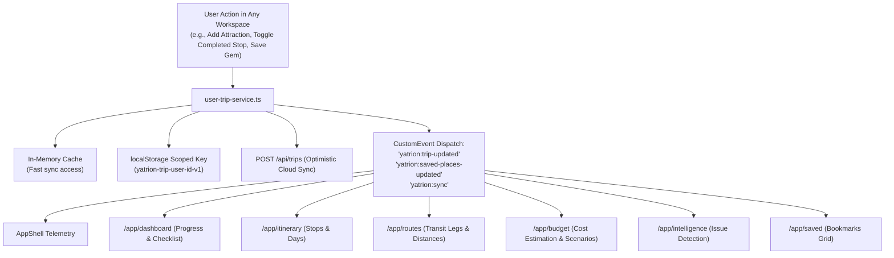

# YATRION PART 11A — PHASE 5 ARCHITECTURE AUDIT & MODULARIZATION PLAN
## Multi-Workspace Routing, State Synchronization & Platform Modularization

**Project:** Yatrion — AI Travel Companion for Karnataka  
**Competition:** Kannada Digital Innovation Hackathon 2026  
**Document:** Architecture Audit & Phase 5 Migration Plan  
**Date:** November 3, 2026  

---

## 1. Executive Assessment & Target Architecture

The Yatrion travel platform has matured through Parts 1–10 (core engines: deterministic itinerary, 6-category budget, bilingual Kannada i18n, voice assistance, route optimization, dynamic budget scenarios, hidden gems discovery, group Borda consensus, adaptive replanning, Open-Meteo CC BY 4.0 weather) and Part 11A (Phases 1–4: authentication, 3D public website, multi-page workspaces, dual-mode LibSQL database, and platform integration).

In Phase 5, the mission is to transform the application into a **fully modular, multi-page travel operating system** where every feature has its own dedicated route, workspace layout, navigation item, and contextual AI intelligence.

### Workspace Mapping Matrix

| # | Workspace Name | Target Route | Existing Source / Location | Migration Strategy |
|---|---|---|---|---|
| **0** | **Personal Dashboard** | `/app/dashboard` | `src/app/app/dashboard/` | Preserved & enhanced with direct workspace shortcuts and active trip telemetry. |
| **1** | **31-District Explorer** | `/app/explore` | `src/components/explore/explore-workspace.tsx` | Enhanced with direct "View Full Details →" links to `/app/attractions/[id]`. |
| **2** | **Attraction Details** | `/app/attractions/[id]` | *New dedicated dynamic route* | Built using `SECULAR_ATTRACTIONS` dataset in `src/lib/explore/district-data.ts`. |
| **3** | **Smart Trip Planner** | `/app/planner` | `src/components/planner/planner-workspace.tsx` | Dedicated creation & parameterization workspace; generates trip and directs to `/app/itinerary`. |
| **4** | **Daily Itinerary** | `/app/itinerary` | *New dedicated workspace* | Extracted from `generated-itinerary.tsx`; editable daily stops, stop notes, day notes, cloud sync badge. |
| **5** | **Route Optimizer** | `/app/routes` | `src/components/routes/routes-workspace.tsx` | Preserved; listens to cross-workspace state events. |
| **6** | **Budget Optimizer** | `/app/budget` | `src/components/budget/budget-workspace.tsx` | Preserved; 3 scenarios (`budget_conscious`, `balanced`, `premium`). |
| **7** | **Hidden Gems & Discovery**| `/app/discover` | `src/components/gems/gems-workspace.tsx` | Relocated to `/app/discover`; `/app/gems` maintained as backward-compatible redirect. |
| **8** | **Group Workspace** | `/app/group` | `src/components/group/group-workspace.tsx` | Preserved; Borda count voting, preference consensus, debt settlement graph. |
| **9** | **Adaptive Intelligence** | `/app/intelligence`| `src/components/adaptive/adaptive-page-wrapper.tsx` | Relocated to `/app/intelligence`; `/app/adaptive` maintained as backward-compatible redirect. |
| **10**| **Weather & Conditions** | `/app/weather` | `src/components/conditions/conditions-workspace.tsx`| Relocated to `/app/weather`; `/app/conditions` maintained as backward-compatible redirect. |
| **11**| **Saved Places** | `/app/saved` | `src/components/saved/saved-workspace.tsx` | Preserved; bookmarked secular attractions with direct "Add to Trip" action. |
| **12**| **My Trips** | `/app/trips` | `src/components/trips/trips-workspace.tsx` | Preserved; multi-trip switching, duplication, and deletion. |
| **13**| **Settings & Profile** | `/app/settings` | `src/components/settings/settings-workspace.tsx` | Preserved; account info, language switcher (English/Kannada), theme, data export. |

---

## 2. Directory & Route Architecture

```
src/
├── app/
│   ├── (auth)/
│   │   ├── login/
│   │   └── signup/
│   ├── api/
│   │   ├── auth/ (login, signup, logout, me, demo)
│   │   ├── chat/ (AI companion with rate limiting & session guard)
│   │   ├── saved-places/
│   │   └── trips/
│   ├── app/
│   │   ├── layout.tsx (AppShell wrapper)
│   │   ├── dashboard/page.tsx
│   │   ├── explore/page.tsx
│   │   ├── attractions/
│   │   │   └── [id]/page.tsx (NEW)
│   │   ├── planner/page.tsx
│   │   ├── itinerary/page.tsx (NEW)
│   │   ├── routes/page.tsx
│   │   ├── budget/page.tsx
│   │   ├── discover/page.tsx (NEW - with /app/gems redirect)
│   │   ├── gems/page.tsx (Backward-compatible redirect/alias)
│   │   ├── group/page.tsx
│   │   ├── intelligence/page.tsx (NEW - with /app/adaptive redirect)
│   │   ├── adaptive/page.tsx (Backward-compatible redirect/alias)
│   │   ├── weather/page.tsx (NEW - with /app/conditions redirect)
│   │   ├── conditions/page.tsx (Backward-compatible redirect/alias)
│   │   ├── saved/page.tsx
│   │   ├── trips/page.tsx
│   │   └── settings/page.tsx
│   └── page.tsx (Public 3D Website)
├── components/
│   ├── layout/
│   │   └── app-shell.tsx (Complete 13-workspace navigation)
│   ├── explore/
│   │   ├── explore-workspace.tsx
│   │   ├── attraction-detail-view.tsx (NEW)
│   │   └── add-to-trip-modal.tsx
│   ├── itinerary/
│   │   └── itinerary-workspace.tsx (NEW)
│   ├── discover/
│   │   └── discover-workspace.tsx (NEW)
│   ├── assistant/
│   │   ├── assistant-panel.tsx (Workspace-aware quick prompts)
│   │   └── floating-assistant-button.tsx
```

---

## 3. Cross-Workspace State Synchronization Architecture

To guarantee that a modification in one workspace immediately propagates across all other workspaces without requiring page reloads or conflicting updates:



Each workspace component registers a clean `useEffect` listener on mount:
```ts
useEffect(() => {
  const handleUpdate = () => {
    const fresh = loadUserTrip(user?.id, user?.isDemo);
    setTripState(fresh);
  };
  window.addEventListener("yatrion:trip-updated", handleUpdate);
  return () => window.removeEventListener("yatrion:trip-updated", handleUpdate);
}, [user?.id, user?.isDemo]);
```

---

## 4. AI Companion Workspace Context Awareness

The AI Assistant (`assistant-panel.tsx` and `assistant-context.tsx`) is upgraded to dynamically resolve the traveler's active route via `usePathname()`. Based on the current route, it provides:

1. **Context Injection:** Sends `currentWorkspace` in the query payload to `/api/chat` so the assistant reasons about the current screen.
2. **Contextual Quick Prompts:** Suggests workspace-specific inquiries:
   - `/app/planner`: "Suggest 3-day heritage circuit", "Optimal pace for children"
   - `/app/itinerary`: "Summarize today's stops", "What should I pack for these stops?"
   - `/app/routes`: "Explain transit efficiency", "Best scenic viewpoints on NH-75"
   - `/app/budget`: "How to reduce stay expenses?", "Free secular attractions nearby"
   - `/app/discover`: "Quiet off-beat spots in Kodagu", "Channapatna toy artisan guilds"
   - `/app/group`: "How to reach consensus on beach vs hills?", "Explain debt settlement"
   - `/app/intelligence`: "Explain current weather alerts", "Review replanning proposal"
   - `/app/weather`: "Monsoon road conditions in Western Ghats", "Trek safety guidelines"
   - `/app/explore` & `/app/attractions`: "Historical context of Badami caves", "Best photographic hours"

---

## 5. Visual Hierarchy & Design System Consistency

- **Color Palette:**
  - Deep Forest Emerald (`#1B4332`, `#2D6A4F`) for primary accents, brand iconography, and active navigation indicators.
  - Sandstone Gold (`#D4A373`, `#B08968`) for badges, highlights, and cultural framing.
  - Warm Ivory & Canvas (`#FAF8F5`, `#F3EFEA`) for backgrounds and cards.
  - Rich Charcoal (`#1F2421`, `#343A40`) for editorial typography.
- **Micro-Interactions:** Subtle card elevations, clean borders (`border-border/80`), accessible focus rings, and zero cartoon illustrations or gratuitous glassmorphism.

---

## 6. Implementation Milestones

1. **Phase 5.1:** Update i18n translation dictionaries (`en.ts`, `kn.ts`) with new workspace keys with 100% structural parity.
2. **Phase 5.2:** Create `/app/attractions/[id]` dynamic route and `attraction-detail-view.tsx`.
3. **Phase 5.3:** Create `/app/itinerary` route and `itinerary-workspace.tsx`.
4. **Phase 5.4:** Create `/app/discover`, `/app/intelligence`, and `/app/weather` routes with backward-compatible redirects from `/app/gems`, `/app/adaptive`, and `/app/conditions`.
5. **Phase 5.5:** Update `app-shell.tsx` navigation sidebar to feature all 13 distinct workspaces + Dashboard.
6. **Phase 5.6:** Integrate cross-workspace event listeners in all workspace components.
7. **Phase 5.7:** Enhance AI Companion with workspace-aware context and quick prompts.
8. **Phase 5.8:** Add Phase 5 verification tests (Tests 326–345) to `scripts/test-engine.ts`.
9. **Phase 5.9:** Execute full verification gates (`npm test`, `npx tsc --noEmit`, `npm run lint`, `npm run build`) and produce implementation report.
