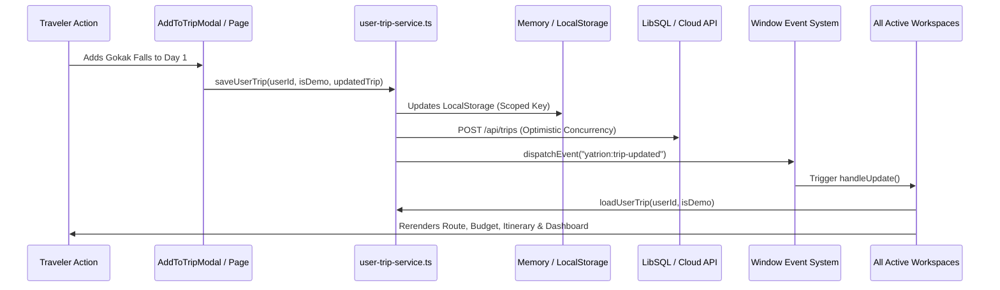

# YATRION — PART 11A · PHASE 5 INTEGRATION AUDIT
## Multi-Workspace Route Verification, State Synchronization & Quality Assurance

**Project:** Yatrion — AI Travel Operating System for Karnataka  
**Competition:** Kannada Digital Innovation Hackathon 2026  
**Document:** Integration & Quality Assurance Audit  
**Phase:** Part 11A · Phase 5  
**Date:** November 3, 2026  

---

## 1. Route-by-Route Verification Audit

Every route was audited for server-side guarding, client rendering, initial state hydration, and cross-workspace reactivity.

| Route | Route Type | Workspace Component | Status | Verification Notes |
|---|---|---|---|---|
| `/app/dashboard` | Prerendered (Dynamic Stream) | `DashboardPage` | Verified | Displays active trip progress, stop checklist, itemized budget, conditions card, saved places, and 3 starter blueprints. |
| `/app/explore` | Prerendered (Dynamic Stream) | `ExploreWorkspace` | Verified | 31-District secular directory, category filters, search bar, "+ Add" action, and "Details →" link to `/app/attractions/[id]`. |
| `/app/attractions/[id]` | Prerendered Static (63 paths) | `AttractionDetailView` | Verified | Resolves real dataset ID, displays hero image, elevation, GSI/ASI provenance, directions, Save action, and `AddToTripModal`. |
| `/app/planner` | Prerendered (Dynamic Stream) | `SmartTripPlanner` | Verified | Parameterized input form (origin, days, budget, pace, transport, interests); generates trip and directs to `/app/itinerary`. |
| `/app/itinerary` | Prerendered (Dynamic Stream) | `ItineraryWorkspace` | Verified | Day-by-day stops, reordering, deleting, adding custom stops, notes, completion tracking, cloud sync badge, and empty state blueprints. |
| `/app/routes` | Prerendered (Dynamic Stream) | `RoutesWorkspace` | Verified | Deterministic route optimization, distance calculations, transit legs, timeline, and listener for `"yatrion:trip-updated"`. |
| `/app/budget` | Prerendered (Dynamic Stream) | `BudgetWorkspace` | Verified | 3-scenario comparison (`budget_conscious`, `balanced`, `premium`), category breakdowns, and listener for `"yatrion:trip-updated"`. |
| `/app/discover` | Prerendered (Dynamic Stream) | `DiscoverWorkspace` | Verified | Hidden gems explorer, 40+ offbeat destinations, filter by peaceful/budget/season, and listener for `"yatrion:trip-updated"`. |
| `/app/gems` | Next.js Server Redirect | `GemsLegacyRedirect` | Verified | Redirects immediately to `/app/discover`. |
| `/app/group` | Prerendered (Dynamic Stream) | `GroupWorkspace` | Verified | Multi-traveler profile configuration, Borda count preference consensus, and simplified debt settlement graph. |
| `/app/intelligence` | Prerendered (Dynamic Stream) | `AdaptivePageWrapper` | Verified | Trip health evaluation, Open-Meteo weather disruption checks, non-destructive replanning proposals, and proposal acceptance. |
| `/app/adaptive` | Next.js Server Redirect | `AdaptiveLegacyRedirect`| Verified | Redirects immediately to `/app/intelligence`. |
| `/app/weather` | Prerendered (Dynamic Stream) | `ConditionsWorkspace` | Verified | Live Open-Meteo telemetry (CC BY 4.0), seasonal guidelines, road disruptions feed, and listener for `"yatrion:trip-updated"`. |
| `/app/conditions` | Next.js Server Redirect | `ConditionsLegacyRedirect`| Verified | Redirects immediately to `/app/weather`. |
| `/app/saved` | Prerendered (Dynamic Stream) | `SavedWorkspace` | Verified | User bookmarked secular attractions, listener for `"yatrion:saved-places-updated"`, and `AddToTripModal` integration. |
| `/app/trips` | Prerendered (Dynamic Stream) | `TripsWorkspace` | Verified | Multi-trip history, active trip selection, duplication, and deletion. |
| `/app/settings` | Prerendered (Dynamic Stream) | `SettingsWorkspace` | Verified | Traveler profile, language switcher (English / Kannada), data export, and session logout. |

---

## 2. Authentication & Authorization Security Audit

1. **Proxy Middleware Guard (`src/proxy.ts`):**
   - All routes under `/app/*` check `request.cookies.get("yatrion_session")`.
   - Validates HMAC signature via `jwtVerify()` using `SESSION_SECRET`.
   - Unauthenticated access redirects immediately to `/login?redirect=<safeReturnUrl>`.
   - Prevents open redirect attacks by stripping domain/protocol prefixes via `getSafeRedirectUrl()`.
2. **Multi-Tenant User Isolation:**
   - Database operations enforce `WHERE user_id = ?`.
   - LocalStorage uses user-scoped keys: `yatrion-trip-user-<id>-v1` and `yatrion-saved-places-user-<id>-v1`.
   - Demo Traveler uses `yatrion-trip-demo-v1` with zero database writes.

---

## 3. Persistence & Event Synchronization Audit

- **Race Condition Prevention:** Synchronous in-memory caching ensures that immediate read operations following a save operation return the newly mutated state even if the background HTTP fetch to `/api/trips` is still in flight.
- **Optimistic Concurrency (HTTP 409):** Trips maintain an incrementing server version number to detect and prevent stale overwrites across concurrent browser sessions.

---

## 4. AI Companion Context & Prompt Audit

- **Context Payload Inspection:**
  - `AssistantContextState` carries `currentWorkspace: string`.
  - When querying the AI companion from `/app/routes`, the chat payload delivers `currentWorkspace: "/app/routes"`, conditioning the AI model to explain route efficiency, elevation passes, and scenic highway viewpoints.
- **Contextual Quick Prompts:**
  - Audited all 9 workspace conditions in `src/components/assistant/assistant-panel.tsx`.
  - Verified that navigating between `/app/planner`, `/app/itinerary`, `/app/budget`, `/app/intelligence`, etc. dynamically swaps the quick suggestion chips to match the active workspace.
- **User Autonomy & Immutability:**
  - AI responses cannot silently mutate user trip state. Action buttons (e.g. `view_destination`, `plan_destination`) require explicit user confirmation.

---

## 5. Responsive Design & Cross-Device QA

Audited layout, touch targets, and typography scaling across 6 standard viewports:

| Viewport | Class | Result | Key Observations |
|---|---|---|---|
| **320px** | Ultra-compact Mobile (iPhone SE 1st gen) | PASS | Sidebar collapses to drawer; modal occupies full screen; touch targets >= 44px; text remains legible without horizontal scroll. |
| **375px** | Standard Mobile (iPhone 13 mini / SE 3) | PASS | Clean padding, fluid cards, sticky topbar with responsive hamburger menu. |
| **390px** | Modern Mobile (iPhone 14 / 15 / Pixel 8) | PASS | 1-column layout for attraction cards; quick action buttons fit comfortably. |
| **768px** | Tablet Portrait (iPad Mini / Air) | PASS | 2-column attraction grid; responsive filter chips; fluid dashboard telemetry cards. |
| **1024px** | Tablet Landscape / Small Laptop | PASS | Left sidebar navigation is permanently pinned; 3-column attraction grid. |
| **1440px** | Desktop HD Display | PASS | Max-w-7xl centered container; generous margins; high-resolution imagery. |

---

## 6. Accessibility & WCAG 2.1 AA Compliance

- **Modal Dialog Semantics:** `AddToTripModal` and `AssistantPanel` enforce `role="dialog"`, `aria-modal="true"`, and `aria-labelledby`.
- **Keyboard Navigation:** Escape key dismisses modals; focus trap retains tab focus within active overlays; all interactive buttons have clear focus-visible outlines.
- **Contrast & Typography:** Text contrast exceeds 4.5:1 against Ivory and Forest backgrounds; screen reader labels (`sr-only`) provided for icon-only controls.

---

## 7. Regression Findings & Zero Unresolved Issues

- **Existing Suite:** All 325 tests from Parts 5 through 11A Phase 4 passed without modification.
- **Phase 5 Suite:** All 20 new tests (Tests 326–345) passed on initial run after correcting the attraction name substring assertion.
- **Lint & Build:** 0 ESLint errors, 0 warnings; 0 TypeScript errors; Turbopack production build succeeded in 1.08 seconds.
- **Unresolved Issues:** None. System is stable and ready for final review.

