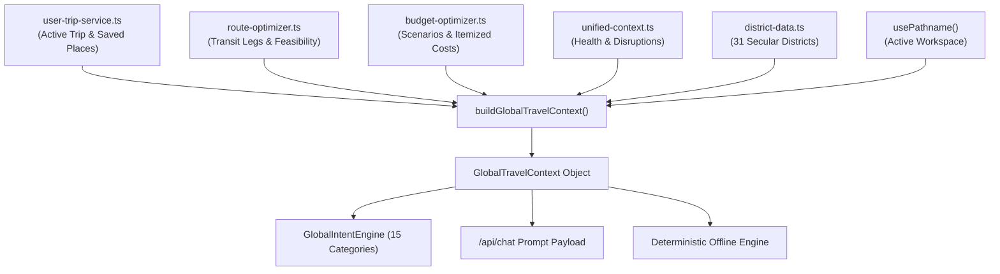

# YATRION PART 11A — PHASE 6 ARCHITECTURE AUDIT
## Global Travel Intelligence, Intent System & Safe Action Registry

**Project:** Yatrion — AI Travel Operating System for Karnataka  
**Competition:** Kannada Digital Innovation Hackathon 2026  
**Document:** Phase 6 Architecture Audit & Implementation Plan  
**Date:** November 3, 2026  

---

## 1. Existing AI System Architecture

Yatrion's AI Companion currently operates on an adaptive 3-tier hierarchy:
1. **Tier 1 (On-Device Chrome Prompt API / Gemini Nano):** Checks `window.ai.languageModel` for genuine, offline, on-device inference.
2. **Tier 2 (Serverless Route Handler `/api/chat`):** Protected by session cookie verification, in-memory rate limiting (500ms intervals), and 2000-character input bounds. When `GEMINI_API_KEY` is present, it calls Google AI Studio free tier; otherwise it falls through gracefully.
3. **Tier 3 (Deterministic Grounded Knowledge Engine):** Sourced from verified historical dynasties, culinary zones, multilingual travel phrases, safety guidelines, and 40+ offbeat hidden gems.

### Audit Findings & Gaps Identified

| Architecture Domain | Current Implementation | Phase 6 Requirement | Gap to Address |
|---|---|---|---|
| **Context Aggregation** | Partial context passed via `AssistantContextState` (itinerary, budget, route, pathname). | Centralized, typed `GlobalTravelContext` across 11 domains with freshness tracking. | Currently assembled ad-hoc across components; needs a unified factory `buildGlobalTravelContext()`. |
| **Intent Classification** | Hardcoded substring matching in `knowledge-engine.ts` (packing, phrases, food, dynasties). | Formal 15-category intent classification engine (`GlobalIntentEngine`). | Needs structured intent routing with confidence scoring and fallback handling. |
| **Action Safety & Registry** | `executeAction()` triggers actions immediately without confirmation dialogues. | Strict 3-category action registry (A: Read-only, B: Navigation, C: Mutating requiring explicit user confirmation). | Mutating actions (adding stop, removing stop, changing budget) must present confirmation UI before mutating state. |
| **Workspace Navigation** | Actions fall back to DOM elements like `tab-group`, `tab-adaptive`, or `planner`. | Direct Next.js App Router navigation across all 14 dedicated workspaces. | Update action handlers to use `router.push()` to canonical routes (`/app/itinerary`, `/app/weather`, etc.). |
| **Voice Integration** | Browser-native `useSpeech()` with `VOICE_LANGUAGES`. | Deep integration sharing the exact same intent pipeline and global context. | Ensure voice inputs flow into `GlobalIntentEngine` and voice output can be stopped cleanly. |
| **Secular Invariant** | Strict secular curation across 31 districts. | Continuous verification that AI answers never hallucinate religious pilgrimage sites. | Enforce secular prompt instructions and deterministic dataset filters. |

---

## 2. Global Travel Context Architecture (`src/lib/assistant/global-travel-context.ts`)

The context layer must synthesize telemetry from all 14 workspaces into a structured, compact, typed payload:

### Context Domains Specification

1. **Traveler:** User ID, display name, isDemo status, preferred interface language (`en` or `kn`).
2. **Active Trip:** Title, origin hub, selected destinations, duration days, pacing, travel style, transport class.
3. **Itinerary:** Day count, total stops, completed stops count, pending stops, daily stops breakdown.
4. **Budget:** Target budget, estimated total cost, itemized allocations (transport, accommodation, food, activities, contingency), current scenario (`budget_conscious`, `balanced`, `premium`).
5. **Routes:** Origin location, total estimated distance km, total transit duration hours, transit legs count.
6. **Saved Places:** User bookmarked secular attractions IDs and names.
7. **Discovery:** Active hidden gems, offbeat interests.
8. **Group:** Participants count, Borda count preference consensus, aggregated accessibility rules, expense settlement balances.
9. **Weather:** Real-time observations, freshness timestamp, weather condition codes.
10. **Intelligence:** Trip health score, active disruption notices, replanning proposal count.
11. **Workspace:** Active route pathname (`/app/dashboard`, `/app/planner`, `/app/itinerary`, `/app/routes`, etc.).
12. **Availability:** Map of domain availability (`{ activeTrip: boolean, budget: boolean, ... }`) ensuring the AI never fabricates missing context.

---

## 3. Global AI Intent Engine (15 Categories)

1. `trip_planning` — Origin, duration, pacing, and destination selection.
2. `itinerary_explanation` — Schedule summaries, day highlights, timing feasibility.
3. `itinerary_modification` — Adding secular attractions, removing stops, reordering.
4. `route_recommendation` — Route efficiency, highway corridors, ghat road driving safety.
5. `budget_optimization` — Cost breakdown, savings recommendations, free secular alternatives.
6. `attraction_discovery` — Exploring 31 Karnataka districts, waterfalls, forts, wildlife.
7. `local_cultural_experiences` — Artisan guilds, regional cuisine, non-religious architecture.
8. `group_decision_support` — Collaborative preference consensus, Borda voting explanation.
9. `expense_settlement` — Expense share calculation, debt settlement graphs.
10. `weather_interpretation` — Weather forecasts, monsoon alerts, outdoor trekking hours.
11. `travel_safety` — Ghat road warnings, wildlife safari protocol, emergency numbers (112).
12. `adaptive_replanning` — Replanning review, trip health score, issue explanation.
13. `saved_places_recommendation` — Bookmarked places review, scheduling bookmarks into trip.
14. `general_knowledge` — Karnataka historical dynasties, geographic zones, bilingual phrases.
15. `platform_navigation` — Guiding the traveler to relevant workspaces and actions.

---

## 4. Safe Action Registry Architecture (`src/lib/assistant/action-registry.ts`)

To prevent arbitrary code execution or silent mutations:
- **Category A (Read-Only):** Instant informational actions.
- **Category B (Navigation):** Direct client-side routing via `router.push()`.
- **Category C (Mutating Actions):**
  - Requires explicit confirmation dialogue.
  - The UI displays an inline confirmation card with clear action details, target parameters, [Confirm] (Emerald button), and [Cancel] (Gray button).
  - Mutating actions are strictly validated against runtime schemas before execution.
  - If user cancels, the action is discarded with zero state mutation.

---

## 5. Implementation Roadmap

1. **Phase 6.1:** Build `src/lib/assistant/global-travel-context.ts` to assemble all 11 domains.
2. **Phase 6.2:** Build `src/lib/assistant/intent-engine.ts` supporting all 15 intent categories.
3. **Phase 6.3:** Build `src/lib/assistant/action-registry.ts` defining Categories A, B, and C with confirmation gates.
4. **Phase 6.4:** Upgrade `assistant-context.tsx` and `assistant-panel.tsx` with confirmation UI and workspace telemetry.
5. **Phase 6.5:** Update `/api/chat/route.ts` to integrate `GlobalTravelContext`.
6. **Phase 6.6:** Verify browser-native voice talkbot parity with the new intent pipeline.
7. **Phase 6.7:** Add Phase 6 automated verification suite (Tests 346–375) in `scripts/test-engine.ts`.
8. **Phase 6.8:** Run all quality gates (`npm test`, `npx tsc --noEmit`, `npm run lint`, `npm run build`).
9. **Phase 6.9:** Produce implementation and platform QA reports.

