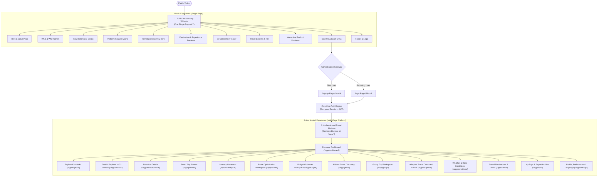
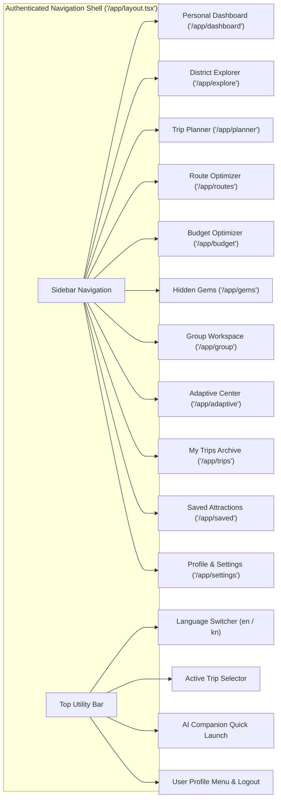
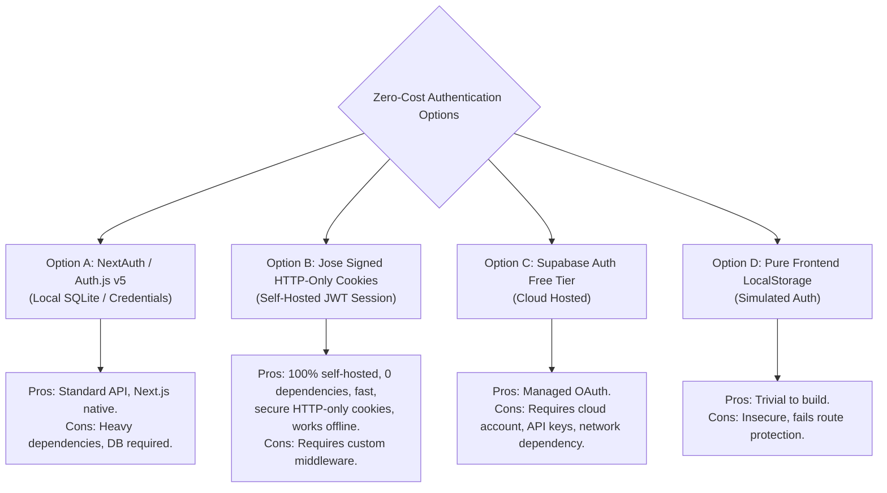
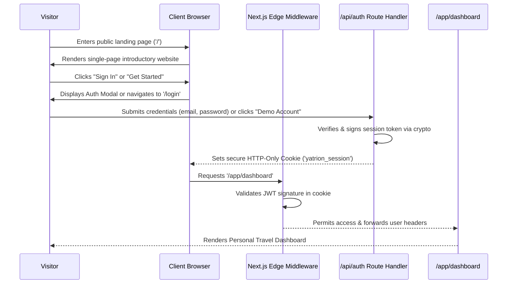
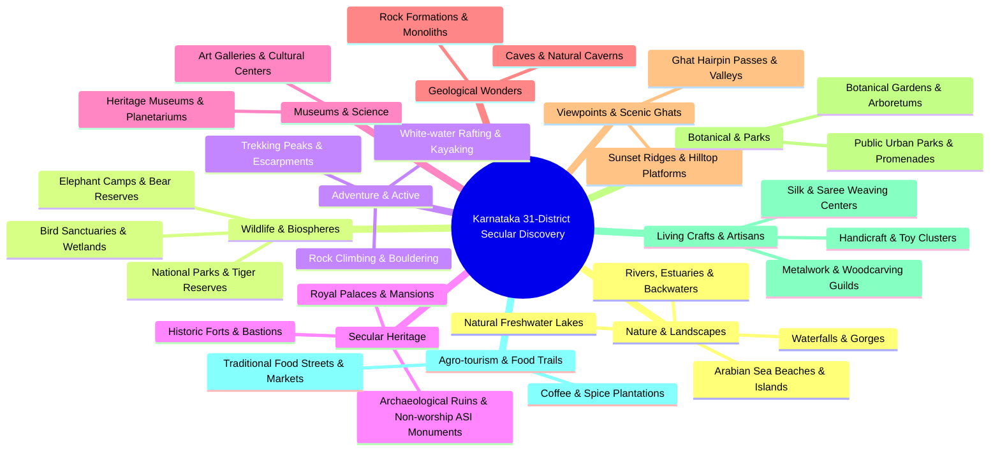

# Yatrion Product Blueprint — Two-Experience Architecture
## Part 11A · Phase 0: Master Product Blueprint

**Project:** Yatrion — Intelligent Travel Planner for Karnataka  
**Document:** Product Blueprint & Architecture Definition  
**Phase:** Part 11A · Phase 0 (Read-Only Planning)  
**Target Architecture:** Decoupled Public Introductory Website & Authenticated Complete Travel Platform  
**Date:** November 2026  

---

## Executive Summary

This blueprint corrects a foundational structural assumption in the previous implementation. Until Part 10, Yatrion compressed its marketing presentation, destination explorer, trip planning engine, route optimizer, budget calculator, hidden gems finder, group workspace, and adaptive travel intelligence dashboard onto a single monolithic page (`src/app/page.tsx`).

This blueprint establishes **two distinct, purpose-built product experiences**:

1. **Public Introductory Website (Single Page):** An immersive, editorial, high-conversion landing page designed exclusively to introduce Yatrion, communicate its value proposition, showcase Karnataka travel intelligence, and compel visitors to sign up or log in. It contains **no** interactive trip planner, no editable itinerary state, and no complex dashboards.
2. **Authenticated Travel Application (Multi-Page Platform):** A secure, feature-rich, workspace-oriented travel operating system accessible strictly after authentication. It is anchored by a **Personal Dashboard** and houses dedicated workspaces for every capability developed across Parts 1–10, expanded with a complete non-religious 31-district Karnataka attraction database.

---

## 1. Experience 1: Public Introductory Website (Single Page)

### 1.1 Objective & Boundaries
* **Core Objective:** Tell a compelling visual and editorial story about exploring Karnataka with intelligent, personalized AI guidance.
* **Strict Boundary:** Visitors **cannot** generate itineraries, edit trip stops, split group expenses, or view live condition dashboards from this page. Every interactive action leads directly to an invitation to **Sign Up** or **Log In**.
* **Navigation Paradigm:** Single-page smooth scroll navigation using anchor IDs (`#what`, `#why`, `#how-it-works`, `#features`, `#discovery`, `#ai-companion`, `#previews`). The top navigation header is locked to the public website and does not show authenticated user controls.

### 1.2 Structure of the 12 Mandatory Sections

| # | Section Name | Content & Functional Intent | Visual Asset / Interaction |
|---|--------------|-----------------------------|----------------------------|
| **1** | **Hero Section** | Bold editorial headline (*"Discover Karnataka, Differently."*), authentic subheadline, primary CTA (*"Start Planning Free"*), secondary CTA (*"Explore Features"*), and ambient Kannada typography (*"ಕರ್ನಾಟಕವನ್ನು ಹೊಸ ದೃಷ್ಟಿಯಲ್ಲಿ ಅನ್ವೇಷಿಸಿ"*). | High-resolution photography of Sharavathi Valley mist or Western Ghats sunset; subtle atmospheric parallax. |
| **2** | **What Yatrion Is** | Concise definition: Karnataka's first deterministic, context-aware AI travel platform that unifies route topography, itemized regional budgeting, group consensus, and adaptive live conditions. | Split-screen editorial layout: high-typography manifesto alongside a framed product mockup. |
| **3** | **Why Yatrion Exists** | Problem vs. Solution breakdown: Existing generic travel tools force tourists onto overcrowded cookie-cutter paths, ignore ghat road detours, miscalculate local vehicle costs, and fail when monsoon rains strike. | Side-by-side comparison cards: *"Generic AI Planners vs. Yatrion Travel Intelligence"*. |
| **4** | **How Yatrion Works** | 3-step intuitive explanation: (1) Select preferences & group mobility; (2) Generate mathematically optimized daily routes; (3) Travel with real-time adaptive guidance. | Minimalist horizontal step stepper with iconography and milestone counters. |
| **5** | **Main Platform Features** | Feature grid spotlighting 6 flagship capabilities: Smart Route Optimization, 3-Tier Budget Optimizer, 40+ Hidden Gems, Collaborative Group Voting, Adaptive Telemetry, and Multilingual Voice AI. | Interactive hover cards with subtle micro-animations highlighting specific algorithms. |
| **6** | **Karnataka Travel Discovery Intro** | Narrative introduction to Karnataka's geographic diversity across 31 districts: Western Ghats rainforests, 320 km Arabian Sea coastline, Deccan Plateau monuments, and pristine wildlife reserves. | Stylized administrative district outline map with interactive region highlights. |
| **7** | **Destination & Experience Previews** | Curated teaser cards for exemplary non-religious Karnataka destinations (Gokarna beaches, Dandeli white-water rafting, Coorg coffee trails, Chitradurga stone fortress, Agumbe rainforest canopy). | Horizontal carousel with verified tags, estimated durations, and *"Sign up to explore all 31 districts"* badges. |
| **8** | **AI Travel Companion Introduction** | Introduction to the bilingual conversational companion: grounded in verified Karnataka geography, non-hallucinatory, browser-native voice talkbot in Kannada, English, Hindi, and Telugu. | Interactive audio/chat simulation preview showing a sample query (*"Will rain affect the ghat roads tomorrow?"*). |
| **9** | **Benefits of Using Yatrion** | Quantifiable traveller benefits: Zero backtracking (saves ~2.5 hrs transit/day), 100% budget transparency, zero crowd fatigue, accessibility-vetted routes for senior citizens. | Editorial stat callouts: *"31 Districts"*, *"1.48x Ghat Calibration"*, *"100% Non-Destructive Guarantee"*. |
| **10** | **Product & Dashboard Previews** | High-fidelity interactive preview of the actual Authenticated Personal Dashboard, Replanning Modal, and Budget Scenario Comparison. | Realistic perspective mockup with interactive tab switcher (Dashboard / Route Map / Budget / Live Health). |
| **11** | **Login & Sign Up Call to Action** | High-conversion terminal banner: *"Your Karnataka journey begins here. Create your free account in 30 seconds."* Direct buttons for Sign Up and Login. | Warm ivory and deep forest green gradient banner with dual CTA buttons. |
| **12** | **Public Footer** | Language switcher (English / Kannada), legal disclaimer, source attributions (Open-Meteo CC BY 4.0, Karnataka Tourism Gazette), copyright notice, and links to top sections. | Minimalist, elegant dark forest footer with authentic Kannada copyright credits. |

---

## 2. Experience 2: Authenticated Complete Travel Application

### 2.1 Workspace Model & Philosophy
Once authenticated, the visitor enters the **Yatrion Travel Platform**. The single-page marketing shell is replaced by an application layout designed for productivity, focus, and multi-trip management.

* **Dedicated Layout (`/app/*`):** Collapsible sidebar navigation, persistent top utility bar (user avatar, active trip indicator, live weather ticker, language toggle, notification bell), and breadcrumb navigation.
* **Workspace Independence:** The user is never forced to navigate an endlessly long page. The Trip Planner, Route Optimizer, Budget Workspace, Group Decisions, and Adaptive Dashboard exist on dedicated routes, while sharing synchronized state through the central storage engine.

### 2.2 Detailed Page Specifications

#### 1. Personal Dashboard (`/app/dashboard`) — The Central Starting Point
* **Active Trip Card:** If the user has an active itinerary, displays the trip title, destination badges, countdown to departure date, total distance, and overall Trip Health status (`Optimal`, `Attention Needed`, `Critical`).
* **Quick Action Hub:** One-click shortcuts to *"New Trip"*, *"Resume Planning"*, *"Explore Districts"*, and *"View Adaptive Health"*.
* **Weather & Regional Alerts Bar:** Live mini-cards for destinations in the user's active trip sourced from Open-Meteo and Karnataka PWD.
* **Recent Activity & Saved Gems:** Carousel of recently bookmarked attractions across Karnataka's 31 districts.
* **Group Trip Notifications:** Pending decisions or expense settlements requiring the user's vote.

#### 2. Explore Karnataka & District Explorer (`/app/explore` & `/app/explore/[district]`)
* **31-District Geographic Grid:** Filter by Karnataka's 4 administrative divisions (Belagavi, Kalaburagi, Bengaluru, Mysuru).
* **Non-Religious Category Filtering:** Nature, Waterfalls, Beaches, Wildlife, Forts, Palaces, Viewpoints, Caves, Adventure, Crafts, Agro-tourism.
* **Interactive District Map:** SVG/Canvas Karnataka district boundary map with hover stats (number of verified non-religious attractions, seasonal highlights).
* **Attraction Detail View (`/app/attractions/[id]`):** High-resolution verified imagery, GPS coordinates, ideal duration, accessibility rating (wheelchair, step-free), entry fee, seasonal advice, and one-click *"Add to Itinerary"* button.

#### 3. Smart Trip Planner & Itinerary Generator (`/app/planner`)
* The core planning engine created in Part 5: allows users to select 1 to 7 travel days, starting origin hub, travel style (`relaxed`, `balanced`, `packed`), budget tier, and group configuration.
* Generates balanced morning, afternoon, and evening slots with terrain-calibrated transit legs.

#### 4. Route Optimization Workspace (`/app/routes`)
* Dedicated interactive route workspace (Part 10 Stage 1): displays total distance, transit hours, elevation/terrain warnings, and Google Maps direction links.
* Features drag-and-drop stop reordering with immediate recalculation of road transit legs and detour factors.

#### 5. Intelligent Budget Optimizer (`/app/budget`)
* Dedicated budget comparison workspace (Part 10 Stage 2): allows side-by-side comparison of **Budget Saver**, **Balanced**, and **Comfort** scenarios.
* Displays 6-category expense breakdowns, vehicle occupancy sharing efficiency, and actionable cost-saving recommendations.

#### 6. Hidden Gems & Offbeat Discovery (`/app/gems`)
* Dedicated catalog of 40+ verified non-religious Karnataka experiences (Part 10 Stage 3): filter by crowd density (`peaceful`, `moderate`), budget ceiling, and seasonal match.

#### 7. Group Trip Planner & Collaborative Workspace (`/app/group`)
* Collaborative decision engine (Part 10 Stage 4): traveller profile management, accessibility aggregation, activity voting (`accepted`, `optional`, `rejected`), and simplified expense settlement ledger (*"Who owes whom"*).

#### 8. Adaptive Travel Command Center (`/app/adaptive`)
* The command center created in Part 10 Stage 5: combines real-time Open-Meteo telemetry, Karnataka PWD disruption bulletins, deterministic issue detection, recommendation cards, and the side-by-side **Replanning Review Modal**.

#### 9. Saved Destinations & My Trips (`/app/saved` & `/app/trips`)
* Storage and export manager: view archived trips, duplicate past itineraries, export formatted plain text (in English or authentic Kannada), and manage offline bookmarks.

#### 10. Profile, Language & Preferences (`/app/settings`)
* User identity preferences: preferred travel style, mobility constraints, default starting city (Bengaluru, Mangaluru, Hubballi, Mysuru), notification toggles, and permanent interface language selection (`en` / `kn`).

---

## 3. Zero-Cost Authentication Architecture

### 3.1 Requirement & Constraints
* **Mandatory Constraint:** Zero paid APIs, zero mandatory credit card registrations, and zero cloud service lock-in.
* **Security Honesty:** If an authentication implementation is client-side or simulated, the application must not falsely advertise enterprise-grade OAuth security. It must provide realistic, robust, self-hosted session management that protects authenticated routes against unauthenticated access.

### 3.2 Evaluation of Zero-Cost Auth Approaches

### 3.3 Recommended Architecture: Self-Hosted Encrypted Cookie Session (`jose` + Next.js Middleware)
We recommend **Option B: Signed HTTP-Only Cookie Session with Demo Accounts and Guest Migration**.

#### How It Operates:
1. **Zero External Dependencies:** Built using standard web standards (`crypto.subtle`, Next.js Edge Middleware, and HTTP-only cookies).
2. **Deterministic Route Protection:**
   * A Next.js Edge Middleware (`middleware.ts`) intercepts all requests matching `/app/*`.
   * If a valid signed session cookie (`yatrion_session`) is absent, the middleware redirects to `/login?redirect=/app/dashboard`.
   * If an authenticated user visits `/login` or `/signup`, the middleware immediately forwards them to `/app/dashboard`.
3. **Demo & Instant Guest Access:**
   * Visitors can create a personalized account with name, email, and password.
   * A one-click *"Try Demo Account"* button allows instant evaluation without filling forms, generating a verified guest session.
4. **Seamless Guest-to-User State Migration:**
   * Any trip preferences, saved gems, or drafted itineraries created before sign-up in `yatrion-trip-v1` are automatically linked to the newly authenticated account on login.

---

## 4. Complete Karnataka Discovery: 31-District Non-Religious Curation

### 4.1 Strict Exclusion Policy: Zero Religious Sites
To honor the core product specification, Yatrion establishes an absolute, filterable exclusion policy:

> [!CAUTION]
> **Strictly Excluded Categories (Zero Tolerance):**
> * Active temples, mutts, and shrines (e.g. Virupaksha sanctum, Krishna Matha, Chamundeshwari Temple, Murudeshwara Temple, Gokarna Mahabaleshwar Temple, Banashankari Temple).
> * Mosques, dargahs, idgahs, and minarets.
> * Churches, basilicas, cathedrals, and chapels.
> * Pilgrimage paths, yatra circuits, and holy bathing ghats.
> * Worship-focused rituals, temple prasadam dining halls, and religious festivals.

### 4.2 Comprehensive Inclusion Taxonomy: 10 Secular Categories
Every tourist attraction across all 31 districts of Karnataka is classified into 10 non-religious categories:

---

## 5. Visual Direction & Design System

### 5.1 Design Philosophy: Authentic Editorial Excellence
Yatrion rejects generic AI aesthetics:
* **No Cartoonish Illustrations:** Replaced by authentic, verified Karnataka photography with true color grading.
* **No Generic Glassmorphism:** Replaced by structured, tactile editorial surfaces with warm ivory, forest green, and subtle borders.
* **No Artificial Gradient Overload:** Natural lighting and depth inspired by Karnataka's diverse physical topography.

### 5.2 Color Tokens & Typographic Hierarchy

| Token Name | Hex Value | Semantic Purpose |
|------------|-----------|------------------|
| `--color-forest` | `#1B4332` | Primary brand color, headers, primary buttons (Western Ghats canopy). |
| `--color-forest-light`| `#2D6A4F` | Hover states, active badges, interactive emphasis. |
| `--color-forest-dark` | `#0B2B1F` | Deep contrast text, authenticated sidebar background. |
| `--color-ivory` | `#FAF7F2` | Public page background, clean canvas. |
| `--color-ivory-warm` | `#F5F0E8` | Card surfaces, container backdrops. |
| `--color-cream` | `#EDE8DC` | Borders, subtle dividers, inactive tabs. |
| `--color-gold` | `#966600` | Accent badges, UNESCO tags, premium indicators (Mysuru gold leaf). |
| `--color-charcoal` | `#2C2C2C` | High-contrast body typography, primary headings. |
| `--color-charcoal-light`| `#4A4A4A` | Secondary descriptions, subheadings, metadata text. |

### 5.3 Kannada Script Typographic Parity
* **Kannada Display:** `"Noto Serif Kannada"`, `"Playfair Display"`, serif — used for majestic cultural headings.
* **Kannada Body:** `"Noto Sans Kannada"`, `"Inter"`, sans-serif — used for crisp, legible UI controls, tabular data, and metrics.

---

## 6. Migration & Feature-Preservation Strategy

All work completed across Parts 1 through 10 will be preserved and relocated:

| Existing Component | Current Location (Monolith) | Target Location (Decoupled Platform) | Preservation Plan |
|--------------------|-----------------------------|--------------------------------------|-------------------|
| `HeroSection` | `src/app/page.tsx` (Top) | Public Website (`/`) | Retained as Section 1, upgraded with dual Auth CTAs. |
| `ExperienceCategories` | `src/app/page.tsx` (Mid) | Public Website (`/`) | Retained as Section 6 & 7 preview. |
| `HowItWorksSection` | `src/app/page.tsx` (Mid) | Public Website (`/`) | Retained as Section 4. |
| `DiscoveryExplorer` | `src/app/page.tsx` (Embedded) | Authenticated Workspace (`/app/gems`) | Upgraded into dedicated workspace with 40+ gems. |
| `SmartTripPlanner` | `src/app/page.tsx` (Bottom) | Authenticated Workspace (`/app/planner`) | Becomes the central trip creation wizard. |
| `GeneratedItineraryView` | `src/components/planner/` | Authenticated Workspace (`/app/itinerary/[id]`) | Preserved with full day-editing and text export. |
| `RouteOverview` | `src/components/routes/` | Authenticated Workspace (`/app/routes`) | Promoted to full-page interactive route optimizer. |
| `BudgetOptimizer` | `src/components/budget/` | Authenticated Workspace (`/app/budget`) | Promoted to dedicated 3-scenario financial workspace. |
| `GroupTripPlanner` | `src/components/group/` | Authenticated Workspace (`/app/group`) | Promoted to dedicated collaborative decision room. |
| `AdaptiveDashboard` | `src/components/adaptive/` | Authenticated Workspace (`/app/adaptive`) | Promoted to live trip command center. |
| `FloatingAssistantButton`| `src/app/layout.tsx` (Global) | Authenticated Platform Shell (`/app/*`) | Preserved; enabled across all authenticated workspaces. |

---

## 7. Phased Implementation Roadmap

* **Phase 0 (Current):** Read-only Architectural Blueprint & Data Strategy Specification (No source code modifications).
* **Phase 1:** Zero-Cost Authentication Engine & Route Protection Infrastructure (`/login`, `/signup`, Edge Middleware).
* **Phase 2:** Public Single-Page Introductory Website (12 sections, smooth scroll, zero application clutter).
* **Phase 3:** Authenticated Application Shell & Personal Dashboard (`/app/layout`, `/app/dashboard`).
* **Phase 4:** Complete 31-District Non-Religious Karnataka Attraction Database & District Explorer (`/app/explore`).
* **Phase 5:** Modular Workspaces Migration (Trip Planner, Route Optimizer, Budget, Hidden Gems, Group, Adaptive).
* **Phase 6:** AI Companion Workspace Deep-Linking, Multilingual Voice QA, and End-to-End Regression Testing.

---

## 8. Conclusion

This blueprint provides the architectural foundation for Yatrion's evolution into a world-class travel platform for the **Kannada Digital Innovation Hackathon 2026**. By decoupling the introductory storytelling page from the authenticated travel operating system, Yatrion achieves optimal user clarity, rapid conversion, and deep functional power.

